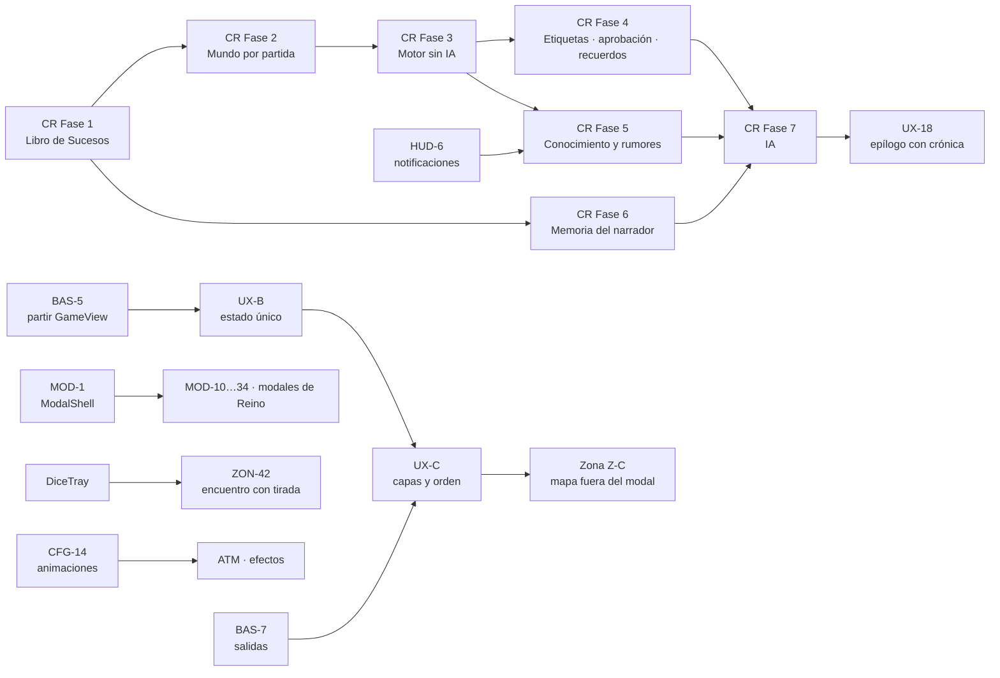

# Roadmap — Tarkor, Berig en alpha

**Actualizado:** 2026-10-01 (mapa de roadmaps); hitos comprobados contra el código el 2026-09-29.
**Versión actual:** Alpha 0 · `v0.0.0-alpha` (etiqueta en `44f8ba3`).
**Siguiente hito:** `0.1` Llanuras estable. Plan de ejecución en
[plan-roadmap-0.1.md](plan-roadmap-0.1.md).
**Historial:** lo cerrado hasta Alpha 0 (el roadmap por trimestres, sus respuestas y el plan de
fases 1-13) está en [archivo/21-roadmap-2026-09-29-alpha0.md](../archivo/21-roadmap-2026-09-29-alpha0.md)
y [archivo/plan-roadmap-oct-2026-alpha0.md](../archivo/plan-roadmap-oct-2026-alpha0.md).

**Roadmaps temáticos (2026-10-01):** este documento es el **roadmap de roadmaps**: fija el orden
y el hito de cada fase de los roadmaps temáticos. Ver [Mapa de roadmaps](#mapa-de-roadmaps).

**Cómo se usa:**
- El roadmap va por **hitos de versión**. Cada hito se cierra entero, se verifica jugando, se
  etiqueta en git y solo entonces se empieza el siguiente.
- Al cerrar un punto se tacha aquí con su commit; el detalle va al registro correspondiente.
- **🧭 = decide Álvaro antes de empezar.** Nada marcado así se implementa sin su respuesta.
- Origen: **[A]** pedido o decidido por Álvaro · **[H]** hallazgo verificado en código · **[P]**
  propuesta de Claude.

---

## Versionado (desde el 2026-09-29, decisión de Álvaro)

Formato: **`A.P.C-etapa+commit`**, por ejemplo `0.1.37-alpha+44f8ba3`.
- **A — versión de juego:** sube en 1 con cada continente nuevo, a modo de DLC. Berig es la `0`;
  Vaelira será la `1`.
- **P — proyecto de desarrollo:** sube en 1 al cerrar cada hito de este roadmap.
- **C — commits:** número de commits desde la etiqueta del hito. Lo calcula git solo
  (`git describe --tags`), nunca se toca a mano.
- **etapa:** `alpha` (ahora), `beta` o nada cuando sea estable.
- **commit:** hash corto del commit exacto, para saber qué código se jugó.

Cada hito cerrado se etiqueta en git (`v0.1.0-alpha`, `v0.2.0-alpha`…). La versión se muestra en
el juego y la devuelve el backend, y cada partida guarda con qué versión se creó y con cuál se jugó
por última vez.

## Hitos de un vistazo

| Versión | Hito | Qué significa terminarlo | Estado |
|---|---|---|---|
| `0.0` | **Alpha 0** | Todo lo hecho hasta el 2026-09-29: Reino, zona, caza, oficios, tiradas visibles, economía y expediciones de facción, relaciones iniciales | ✅ `v0.0.0-alpha` |
| `0.1` | **Llanuras estable** | Una partida completa con Gorhorn en Las Llanuras sin nada que rompa el juego, verificada jugando | ▶ Siguiente |
| `0.2` | **Facciones vivas** | Las facciones sobreviven, deciden y actúan solas; el jugador ve y sufre las consecuencias | Pendiente |
| `0.3` | **Reino profundo** | Población que llega, forma familia y trabaja; ganadería; defensa | Pendiente |
| `0.4` | **Berig abierto: Cristal Helado** | Viajar entre regiones y jugar una segunda región completa | Pendiente |
| `0.5` | **Ciénaga Troncal** | Tercera región jugable con sus oficios y Maestros | Pendiente |
| `0.6` | **Margen Silencioso y Meseta del Orden** | Berig entero jugable | Pendiente |
| `0.7` | **Personaje propio** | Crear un personaje desde cero, sin ser Gorhorn, con cualquier raza de Berig | Pendiente |
| `0.8` | **Beta de Berig** | Instalador, rendimiento en la Steam Deck, narrador local afinado; paso a `-beta` | Pendiente |
| `1.0` | **Vaelira** | Segundo continente (DLC) | Lejano |

---

## Mapa de roadmaps

### Los documentos

| Roadmap | Qué cubre | Prefijos de sus tareas |
|---|---|---|
| **Este documento** | Hitos de versión: contenido, mecánicas, regiones, robustez | — |
| [plan-roadmap-0.1.md](plan-roadmap-0.1.md) | Plan de ejecución del hito actual | Fases A-G |
| [roadmap-front.md](roadmap-front.md) | Diseño, componentes, configuración, tiradas, modales, paneles, HUD, narración, combate, atmósfera, pantallas previas, sonido | `CFG` `BAS` `DAD` `MOD` `PAN` `HUD` `NAR` `CMB` `ATM` `PRE` `SON` `QA` |
| [roadmap-front-ux.md](roadmap-front-ux.md) | Flujos, orden de vistas, bloqueos, entrada y salida | `UX` |
| [roadmap-front-zona.md](roadmap-front-zona.md) | Mapa de zona: acceso, fichas, movimiento, amenaza, cámara | `ZON` (fases Z-A…Z-F) |
| [roadmap-front-reino.md](roadmap-front-reino.md) | Panel de Reino: información y gestión | `REI` (fases R-A…R-F) |
| [roadmap-cronista.md](roadmap-cronista.md) | Historia viva de cada partida: Libro de Sucesos, mundo por partida, consecuencias, IA que escribe el lore | `CR` (fases 1-8) |

### Cómo se reparten

- Cada hito tiene **dos o tres pistas** que avanzan a la vez: **juego** (lo de este documento),
  **mundo vivo** (Cronista) e **interfaz** (front, UX, zona, Reino).
- **Una fase temática entra en el hito donde se necesita**, no antes: la interfaz de algo llega con
  ese algo, y las bases técnicas llegan justo antes de lo que las usa.
- **En `0.1` solo entran arreglos** (sigue la congelación del hito); lo grande empieza en `0.2`.
- Las tareas conservan el identificador de su roadmap (p. ej. `UX-3`, `CR-12`); al cerrarlas se
  tachan **en su roadmap y aquí**.
- **Todas las tareas tienen hito.** `python3 tools/roadmap/cobertura.py` cruza las tareas de los
  cinco roadmaps con la tabla de abajo (rangos, fases R/Z/UX y fases del Cronista) y lista las que
  no tienen ninguno. Revisión del 2026-10-02: había 28 sin hito (BAS-9, 15 de Reino, 11 de zona y el
  resumen PAN-7); se repartieron en sus fases y ahora son 0 de 367.

### Qué entra en cada hito

| Hito | Juego (este documento) | Mundo vivo (Cronista) | Interfaz (front · UX · zona · Reino) |
|---|---|---|---|
| **`0.1` Llanuras estable** | Fases A-G del plan del 0.1 | ~~**CR Fase 1 mínima** (`CR-1`…`CR-4`)~~ → pasa al `0.2` (Fase A de su plan, 2026-10-02): la Fase D del `0.1` se cerró sin ella (noticias desde expediciones) | **Arreglos:** ~~`UX-3`~~ ✅, ~~`UX-4`~~ ✅, ~~`UX-13`~~ ✅, ~~`UX-16`~~ ✅, ~~`UX-24`~~ ✅ · ~~`DAD-1`…`DAD-6`~~ ✅ (fallos de Tameo y tiradas) · ~~`CFG-33`~~ ✅ (ocultar herramientas de admin) · ~~`BAS-1`~~ ✅ (fuentes empaquetadas) · ~~**Reino R-A**~~ ✅ (`REI-110`…`REI-116`, `REI-33`, `REI-40`, `REI-41`) · ~~**Z-A** del mapa de zona~~ ✅ (legibilidad: `ZON-10`, `11`, `13`, `14`, `17`, `19`, `20`, `62`) con los iconos del mapa de `BAS-2` |
| **`0.2` Facciones vivas** ([plan](plan-roadmap-0.2.md)) | Economía de supervivencia, IA de decisión de facción, motor de eventos, combate NPC 20+, comercio de volumen | **CR Fase 1** (`CR-1`…`CR-4`, Libro de Sucesos, venida del `0.1`) y **CR Fases 2, 3 y 5:** mundo por partida; motor sin IA (reacciones, consecuencias aplazadas, narrador de fondo, caída/escisión/fundación, nacimientos); conocimiento y rumores con la vista de Leyendas. El "motor de eventos de mundo unificado" de este hito **es** el de `roadmap-cronista.md` § 7 | **Configuración básica** `CFG-1`…`CFG-6`, `CFG-9`, `CFG-13`, `CFG-14`, `CFG-20`, `CFG-26`, `CFG-28` · **Base técnica** ~~`BAS-3`, `BAS-5`, `BAS-7`, `BAS-8`, `BAS-9` (catálogo visual)~~ ✅ · **Modales** `MOD-1`…`MOD-6` · **UX-B** (estado único), **UX-C** (capas y orden), `UX-6` (un narrador a la vez) y `UX-14` · `HUD-6` (notificaciones), `HUD-12` · **Zona** ~~Z-B~~ ✅, Z-C, ~~Z-D~~ ✅ · ~~`CR-19`, `CR-20` y `PAN-9b` (Leyendas)~~ ✅ · ~~`INT-1`…`INT-4`, `INT-9`, `NAR-9`~~ ✅, ~~`CFG-34`~~ ✅, ~~`CFG-35`~~ ✅ · **UX-F** ~~`UX-29`…`UX-31`, `UX-35`, `UX-36`~~ ✅ 2026-10-05, `UX-38` · ~~**Retro de la Fase D** `QA-8`…`QA-12`~~ ✅ |
| **`0.3` Reino profundo** ([plan](plan-roadmap-0.3.md)) | Población y reproducción, ganadería, defensa, postura de compañero, "Charlar con NPC", campamentos de bandidos (~~`CR-50`~~ ✅), comercio en persona con NPC (`CR-51`) | **CR Fases 4 y 6:** etiquetas, aprobación de compañeros, recuerdos de NPC, hilos; memoria del narrador | **Reino** R-B, R-C, R-D, R-E (`PAN-7` es el resumen de estas fases) · `DAD-7`…`DAD-12` (`DiceTray`) y, si se aprueban, `DAD-13`…`DAD-15` · `HUD-1`…`HUD-5`, `HUD-7`…`HUD-11` · `NAR-1`…`NAR-8` · `CMB-1`…`CMB-8`, `CMB-10` (castigo por estado en porcentaje) · `PAN-1`…`PAN-6`, `PAN-11` y `PAN-12`…`PAN-14` · UX-D parcial (`UX-18` epílogo, primero con textos de plantilla; la crónica llega en `0.4` con `INT-12`), `UX-19`, `UX-20` · `INT-5`…`INT-8`, `INT-10`, `INT-11`, `NAR-10`, `NAR-11`, `NAR-12` (texto libre para lo que tiene sentido), `HUD-13`, `CFG-36`, ampliaciones de `PAN-4`, `PAN-6`, `PAN-11`, `PAN-12` · **UX-F** `UX-32`…`UX-34`, `UX-39` · **Población** ~~`REI-118`~~ ✅, ~~`REI-119`~~ ✅, ~~`REI-120`~~ ✅, ~~`REI-121`~~ ✅, ~~`CR-52`~~ ✅ (linajes y rastros) · **Economía y ganadería** ~~`CR-53`~~ ✅, ~~`CR-54`~~ ✅, ~~`CR-55`~~ ✅, ~~`CR-56`~~ ✅, ~~`CR-61`~~ ✅, ~~`CR-62`~~ ✅, ~~`CR-63`~~ ✅, ~~`CR-58`~~ ✅, ~~`CR-59`~~ ✅ · **Conflicto** ~~`CR-65`~~ ✅ (defensa y milicia), `CR-66` (postura), ~~`CR-67`~~ ✅ (intensidad de asaltos), `CR-68` (testigos que juzgan quién muere), `CR-69` (rumores que viajan con quien los vio) · **Retros** `QA-13`…`QA-25`, ~~`QA-28`…`QA-51`~~ ✅, `QA-52` (intermitente de `avanceDiario`), ~~`QA-53`~~ ✅, ~~`QA-54`…`QA-61`~~ ✅ (retro de la tercera tanda), ~~`QA-62`…`QA-65`~~ ✅ (retro del último tramo), ~~`QA-66`…`QA-70`~~ ✅ (retro de la tercera tanda de `QA-27`), ~~`QA-71`, `QA-72`~~ ✅ (retro del PR #51), ~~`QA-74`…`QA-76`~~ ✅ y `QA-73` 🚧 (retro del PR #50), ~~`QA-77`…`QA-80`~~ ✅ (retro del PR #53), ~~`QA-81`~~ ✅ (retro del PR #54), ~~`QA-82`…`QA-87`~~ ✅ (retro de la ronda `QA-27` del 2026-10-14), ~~`QA-88`, `QA-89`~~ ✅ (retro de los hallazgos de `QA-27`, 2026-10-15), ~~`QA-90`…`QA-93`~~ ✅ (retro del PR #60, 2026-10-17), ~~`QA-94`…`QA-97`~~ ✅ (retro de la ronda tras el PR #60, 2026-10-17), ~~`QA-98`…`QA-100`~~ ✅ (retro de P189-P205, 2026-10-19), ~~`QA-101`…`QA-107`~~ ✅ (proceso de pruebas, 2026-10-19), ~~`QA-108`~~ ✅ (mapa del agente, 2026-10-19) · **De la ronda `QA-27`** (usuaria, 2026-10-13): `REI-122` (permiso para fundar), `ZON-88` (peligro en el aviso de salida), `ZON-89` (fauna y flora en fichas pequeñas), `HUD-14` (aviso de la Enciclopedia) · **Pruebas** `QA-27` (ronda jugando, 2026-10-09) y `ZON-87` (puntos fijos según la ilustración) |
| **`0.4` Cristal Helado** | Viaje largo entre regiones, Cristal Helado jugable | **CR Fase 7:** IA (cola con prioridades, Escriba, Cronista, Árbitro, epílogo) y `CR-41` (rumores falsos o deformados) | **Zona** Z-E (hora del día, cámara, `ZON-72` viaje entre zonas) · `ATM-1`, `ATM-2` (tema por región), `ATM-6` · `PAN-8`…`PAN-10` · `MOD-15`…`MOD-19` · `INT-12` (epílogo con la crónica) · `CFG-37` · `CR-57` (monturas) · `CR-60` (ingresos pasivos) · `CR-64` (todo viaja de verdad: expediciones, caravanas, patrullas, migraciones, llegadas… como viajeros en el mapa) |
| **`0.5` Ciénaga Troncal** | Oficios y Maestros Goshg, zonas de la Ciénaga | **CR Fase 8:** pulido, simulaciones largas, exportar leyendas | **Zona** Z-F · **Reino** R-F (plano, red de producción) · resto de `MOD-10`…`MOD-34` · UX-E (`UX-21`…`UX-25`, `UX-27`, `UX-28`) |
| **`0.6` Margen y Meseta** | Berig entero, control de escuadrones | Pesos y presupuesto ajustados con Berig entero | `BAS-2` completo y `BAS-4` (iconos y tokens), `BAS-6` · `ATM-3`…`ATM-5`, `ATM-7`, `ATM-8` · `PRE-1`, `PRE-2`, `PRE-4`, `PRE-6`, `PRE-7` · resto de `CFG` (`CFG-10`…`CFG-12`, `CFG-15`…`CFG-19`, `CFG-21`…`CFG-24`, `CFG-27`, `CFG-29`…`CFG-32`) · `ZON-21` (modo daltónico del mapa, con `CFG-29`) |
| **`0.7` Personaje propio** | Creación completa, punto de inicio por raza | Sucesos fundacionales por origen del personaje; trasfondo del personaje con el Cronista (🧭 vía b) | `UX-15`, `UX-17` (asistente de nueva partida) · `PRE-3`, `PRE-5` · `UX-26` (primeros pasos) |
| **`0.8` Beta de Berig** | **Fase única de pruebas** (decisión de la usuaria, 2026-10-02): pasada de juego completa por todo lo implementado desde el `0.1` — retoma el guion y los hallazgos pendientes de [`fase-g-0.1-hallazgos.md`](../registros/fase-g-0.1-hallazgos.md) — y arreglo de lo que salga · Instalador, narrador afinado, curvas dinámicas, rendimiento · `CMB-9` (tope de combatientes de 4 a 6-8) | Destilar un cronista propio desde los ejemplos capturados | `CFG-7`, `CFG-8` nativos con Tauri · `CFG-25` y **Sonido** `SON-1`…`SON-6` · `QA-1`…`QA-7` completo · `QA-26` (cifras provisionales) |
| **`1.0` Vaelira** | Segundo continente | Legado entre partidas, si se aprueba (D-8 del Cronista) | `ATM-2` para las regiones de Vaelira |

### Dependencias que mandan el orden

Reglas que salen del gráfico:
1. **Nada del Cronista sin la Fase 1**, y nada que decida por partida sin la Fase 2.
2. **`BAS-5` (partir `GameView.tsx`) antes de tocar el estado de la partida** (UX-B) y antes de
   sacar el mapa del modal (Z-C).
3. **El gestor de capas (UX-C) antes de que el Cronista empiece a avisar de sucesos**: si no, los
   rumores y consecuencias se amontonarían como hoy los modales.
4. **La IA (CR Fase 7) va al final** de su pista: todo lo anterior funciona sin ella.
5. **Continuo, en cada hito:** `QA` del roadmap de front, `ZON-80`…`ZON-86` (técnica del mapa) y
   las pruebas de `roadmap-cronista.md` § 18 acompañan a la fase que tocan; no son una fase aparte.

### Orden dentro de cada hito

1. **Arreglos** que afectan a lo que se va a verificar.
2. **Bases** (datos, estado, componentes) que el resto del hito necesita.
3. **Mecánica de juego** del hito.
4. **Mundo vivo** que la acompaña.
5. **Interfaz** de todo lo anterior.
6. **Pasada de juego completa** con el guion del hito y etiqueta.

---

## `0.1` — Llanuras estable ▶

**Roadmaps temáticos en este hito:** arreglos de UX, tiradas, Reino y legibilidad del mapa de zona; Libro de Sucesos mínimo. Ver [Mapa de roadmaps](#qué-entra-en-cada-hito).

Regla del hito: **congelación de funcionalidades nuevas grandes**. Solo entra lo que hace falta
para que la partida en Las Llanuras sea sólida.

### Verificación jugando
- **Pasada de juego completa con Gorhorn** siguiendo un guion (primer turno y Gistera, zona y
  movimiento, caza en solitario y en grupo, cadáveres, recolección de cada oficio, combate con
  muerte y renacer, compañeros, Reino: fundar, construir, producir, taller con trabajador,
  diplomacia, mercado). Cada fallo se apunta y se arregla dentro del hito. **[P]**
- Lo que quedó sin verificar de Alpha 0: Goirnos al saquear un humanoide, Taller con trabajador,
  la ficha de flora (`44f8ba3`), la vida tras el golpe (`15d6ec2`), expediciones. **[H]**

### Huecos que se notan al jugar
- **Súbditos del Reino, versión mínima** (F9-7): llegada de pobladores desde la población de su
  raza cuando hay vivienda, comida y agua. Primera pieza de la propuesta de población. 🧭 Revisar
  antes la propuesta en `propuestas-lore.md`. **[A]**
- **El mundo vivo, visible:** noticias en el registro cuando una expedición vuelve, es
  interceptada o hay bajas, y cuando cambia la relación entre facciones. **[P]**
  Se construye sobre el Libro de Sucesos mínimo (`CR-1`…`CR-4` de
  [roadmap-cronista.md](roadmap-cronista.md)) para no hacerlo dos veces. 🧭 Si se prefiere no
  adelantarlo, la Fase D se hace como estaba y el Libro entra en `0.2`.
- **Migrar `worldAgenda.ts`** (conflicto fijo Serhu+Concordia contra Helsig+Goshg) a las
  `FactionRelation` reales. **[A]**
- **Maestro de diplomacia** (H-5, mitad hecha: ya sube por negociación). 🧭 Quién enseña y dónde. **[A]**

### Robustez
- ~~**Versión visible y grabada en cada partida**~~ ✅ `bf473bc` **[A]**
- ~~**Partidas que sobreviven a una actualización:**~~ ✅ `0bc4867` (`sync-item-catalog`). copias de objetos con estadísticas antiguas
  (reequilibrio del 2026-09-29), ofertas persistidas sin campos nuevos, migraciones al arrancar. **[P]**
- **Test intermitente de combate múltiple** (registro de deuda, 2026-09-29): causa raíz. **[H]**
- **Integración continua en verde**: la CI de GitHub lleva en rojo desde que existen los tests con
  Postgres real; le falta el servicio de base de datos. **[H]**

### Rendimiento
- **Latencia real por turno en la Steam Deck** y objetivo fijado. **[A]**

**Hecho cuando:** el guion completo se juega de principio a fin sin bloqueos, la suite está verde
en CI, y la latencia está medida. Se etiqueta `v0.1.0-alpha`.

---

## `0.2` — Facciones vivas

**Roadmaps temáticos en este hito:** Cronista fases 2, 3 y 5 (mundo por partida, motor de sucesos, rumores y Leyendas); configuración básica, estado único y capas de UX; mapa de zona Z-B…Z-D. Ver [Mapa de roadmaps](#qué-entra-en-cada-hito).

- **Economía de supervivencia de facción**: almacén con tope por edificios, agua obligatoria,
  comida y producción activa, sueldos en Goirnos, cascada de declive hasta la extinción.
  Propuesta en `propuestas-lore.md`, 🧭 números por decidir. **[A]**
  Dato de partida (2026-09-29): con la regla actual, el Clan Serhu (500 soldados, 150 trabajadores)
  pierde riqueza cada día hasta quedarse en 0 para siempre; el equilibrio de sueldos y rendimiento
  tiene que salir de este hito. **[H]**
- **IA de decisión de facción** según la Inteligencia de su líder (`liderNpcId`): construir,
  expandirse, pactar, declarar la guerra, lanzar expediciones. Las carencias de supervivencia son
  sus disparadores. **[A]** → ~~`CR-34`~~ ✅ 2026-10-05 (y ~~`CR-35`~~ ✅; construir `CR-36`, guerra contra el Reino `CR-37` y
  territorios y expansión `CR-39` van al `0.3`).
- **Motor de eventos de mundo unificado**: eventos discretos que alimentan relaciones, lore y
  misiones; función pura llamada desde el turno y desde `worldTick`. **[A]**
  Diseño completo en [roadmap-cronista.md](roadmap-cronista.md) § 7 (reacciones, consecuencias
  aplazadas, narrador de fondo); requiere antes el mundo por partida (Cronista, Fase 2).
- **Misiones secundarias por motor** en vez de por el LLM (momento de revisitar la fusión de los
  tres `pending*Offer`). **[A]** → ~~`CR-40`~~ ✅ 2026-10-05 (fusión de `pending*Offer` descartada: ADR 0001).
- **IA de combate NPC, tramo Inteligencia 20+**: retirada (decidida: huida inmediata con tirada),
  concentrar ataques en el mismo objetivo y órdenes de un capitán. **[A]** → ~~`CR-44`~~ ✅ 2026-10-05 (moral y
  retirada para todo NPC con mente) y ~~`CR-45`~~ ✅ 2026-10-05 (capitán y ataques concentrados).
- **Comercio de volumen Reino↔facción**: todo el catálogo, según el origen del objeto y el oficio
  de los NPC por raza y región. **[A]** → ~~`CR-47`~~ ✅ 2026-10-05 (fórmula decidida por la usuaria el 2026-10-05:
  Mercado con órdenes permanentes, caravanas del Reino y precio unidad a unidad).
- ~~Expediciones: que se vean en el mapa de mundo.~~ **[P]** → ~~`CR-46`~~ ✅ 2026-10-05.
- ~~Pasada de rendimiento del `worldTick` con el motor completo.~~ **[P]** → ~~`CR-48`~~ ✅ 2026-10-05 (ya es el avance diario: `CR-7`).

## `0.3` — Reino profundo

**Roadmaps temáticos en este hito:** Reino R-B…R-E; Cronista fases 4 y 6 (etiquetas, aprobación, recuerdos, memoria del narrador); `DiceTray`, HUD, narración y combate. Ver [Mapa de roadmaps](#qué-entra-en-cada-hito).

- **Población y reproducción al estilo Medieval Dynasty**, a tiempo real de juego: parejas, crías
  que crecen, vejez, muerte y marchas. Propuesta en `propuestas-lore.md`. 🧭 Edad adulta y vida de
  Goirntes, Nabieus y Faerus. **[A]**
- **Ganadería**: oficio de ganadero por raza y región y un corral por especie (Murgol, Corretolvas,
  Canizor, Cuernahoja; nunca el Corredor de Cauce). Propuesta en `propuestas-lore.md`. **[A]**
- Estaciones de recolección sin oficio (Leñera, Cantera, Fibrería), si hacen falta. **[P]**
- Edificios de defensa (empalizada, torre de vigía, foso) para los Cuarteles de Guerra. **[P]**
- Postura de compañero en combate (agresivo, defensivo, capturador, clemente). **[A]**
- **"Charlar con NPC" enriquecido** (Franja 4 del plan Interactuar): lore, reclutar e interrogar
  tras Clemente. 🧭 Falta la especificación. **[A]**

## `0.4` — Berig abierto: Cristal Helado

**Roadmaps temáticos en este hito:** Cronista fase 7 (IA); mapa de zona Z-E; tema por región. Ver [Mapa de roadmaps](#qué-entra-en-cada-hito).

- **Viaje largo entre regiones** desde el mapa de mundo. 🧭 Hoy aparcado (la habilidad Viajar
  exige montura): decidir si se viaja a pie o se implementan antes las monturas. **[A]**
- **Cristal Helado jugable**: `ZonePoint` y grupos de fauna, recorrido de sus zonas, Maestros
  Helsig. **[A]**
- Sembrar la Casa de curas Helsig y el Obrador de piedra Serhu cuando existan sus Maestros. **[H]**

## `0.5` — Ciénaga Troncal

**Roadmaps temáticos en este hito:** Cronista fase 8; mapa de zona Z-F; Reino R-F; resto de modales y UX-E. Ver [Mapa de roadmaps](#qué-entra-en-cada-hito).

- Oficios de la Ciénaga (`carpintero-orcos-cienaga`, `cocinero-orcos-cienaga`, resinero) y los
  Maestros Goshg, para que sus talleres del lore sean edificios. **[A]**
- Edificios de facción Goshg en `campamento-goshg-interior`. **[H]**
- Zonas, fauna y recorrido de la región. **[A]**

## `0.6` — Margen Silencioso y Meseta del Orden

**Roadmaps temáticos en este hito:** iconos y tokens, atmósfera, pantallas previas, resto de Configuración. Ver [Mapa de roadmaps](#qué-entra-en-cada-hito).

- Zonas, fauna, oficios y Maestros de las dos regiones (Keseg Sael, Feg Tusha, Concordia de
  Hierro, Los del Obelisco). **[A]**
- Opcionales de las fichas aprobadas: interior del Archivo del Refugio, `ZonePoint` del Jakut. **[A]**
- **Control de escuadrones** (patrullar, explorar), si el mundo vivo lo pide. **[A]**

## `0.7` — Personaje propio

**Roadmaps temáticos en este hito:** asistente de nueva partida (`UX-15`), creación de personaje (`PRE-3`, `PRE-5`), primeros pasos (`UX-26`); trasfondo con el Cronista. Ver [Mapa de roadmaps](#qué-entra-en-cada-hito).

Decisión de Álvaro (2026-09-29): antes de Vaelira hay que poder jugar con un personaje creado
desde cero, no solo con Gorhorn. Va después de tener Berig entero porque cada raza necesita su
región jugable como punto de inicio. El backend ya conserva una vía de "partida custom" de antes
de restringir el juego a Gorhorn (`routes/saves/creation.ts`); se parte de ahí.
- **Creación completa:** nombre, raza de Berig (Goirntes, orcos con su variante de clan y región,
  Nabieus, Faerus), clase respetando sus restricciones de raza, reparto de atributos, origen y
  motivación. **[A]**
- **Punto de inicio por raza y región**, con su introducción narrativa propia y su kit inicial
  (equipo, habilidades de clase y raciales, oficio de partida si procede). **[A]**
- **Reputación inicial** con las facciones según el origen elegido (un Faerus de Kegi no empieza
  igual con el Clan Serhu que un orco Serhu). **[A]**
- Enciclopedia y narrador sin suposiciones de "eres Gorhorn": revisar textos, prompts y fragmentos
  del RAG que den por hecho su historia. **[P]**
- 🧭 Puntos de atributo y límites, orígenes permitidos por raza, y si Gorhorn se queda como
  personaje de inicio rápido. **[A]**
- 🧭 **Trasfondo del personaje** (idea de Álvaro, 2026-09-29, se diseña al llegar a este hito): dos
  vías. (a) El juego genera el trasfondo automáticamente a partir de raza, origen y clase. (b) El
  jugador da sus datos y la IA local (o un motor aparte) redacta un trasfondo mínimo coherente con
  el canon. **[A]**

## `0.8` — Beta de Berig

**Roadmaps temáticos en este hito:** resolución y ventana nativas con Tauri, sonido, calidad (`QA`), cronista propio destilado. Ver [Mapa de roadmaps](#qué-entra-en-cada-hito).

- **Instalador** (investigación en [20-instalador-distribuible.md](../arquitectura/20-instalador-distribuible.md)). **[A]**
- **Narrador local afinado** (guía en [fine-tuning-ia-local.md](../ia/fine-tuning-ia-local.md)):
  dataset de partidas reales, con el vocabulario del lore actual ("brillo de aurora", Holdo…). **[A]**
- **Curvas dinámicas** (§ 9 del diseño X4): pasada de *grounding* sobre movimiento en zona,
  oficios, talento y energía antes de diseñar nada. **[A]**
- Rendimiento aceptable en la Steam Deck con Berig entero. **[A]**

**Hecho cuando:** Berig se juega entero, con Gorhorn o con un personaje propio; se etiqueta
`v0.8.0-beta`. Berig estable = quitar la etapa.

## `1.0` — Vaelira (DLC)

Segundo continente: Kelife, Kalisar, Jusaly, Ilvenar y sus cuatro personajes. Fuera de juego hasta
que Berig sea estable.

---

## Continuo: lore y documentación

- **Rondas de OpenCode** con la capa `canon-opencode/`. Primera prueba de control pendiente:
  `FAUNA margen`, `ITEMS llanuras` y `EVENTOS` orco, con HUECOS → ESCRIBE → REVISA. **[A]**
- **Propuestas SIN REVISAR** en [propuestas-lore.md](../borradores-opencode/propuestas-lore.md):
  población y reproducción, supervivencia de facción, ganadería, Dessa/Yerin/Riko como NPC. **[A]**
- `jakut-ger-interior`: interior (ciudadela) del Jakut Ger de los Feg Ger. 🧭 Qué hay dentro. **[H]**
- `razas.md` y `personajes.md` siguen hablando de "8 razas jugables" y "pregenerados"; solo
  Gorhorn es jugable. **[H]**
- Revisar la incoherencia de distancias: Karot Veku a ~110 km del Cruce en el mapa de Azgaar y a
  18-25 km en el grafo del juego. **[A]**
- `ampliar lore` de Las Llanuras: parado en la zona 15-17 (ver
  [ampliar-lore-checklist.md](../registros/ampliar-lore-checklist.md)). **[A]**
- Tras cada cambio de lore: fragmentos del RAG (`loreChunks.ts`) al día y `./actualizar-mundo.sh`
  en local. **[P]**
- Documentación: convención "estado arriba, historial abajo" en el resto de `mecanicas/` y
  `rpgtarkor/`. **[P]**
- Registros: pasar las entradas cerradas de `revisar-partida-hallazgos.md`,
  `checklist-pruebas-juego.md` y `deuda-tecnica-hallazgos.md` a `archivo/`. **[P]**
- Prompts de imagen por nivel de Ayuntamiento y Cuartel, con los huecos de parcela (los genera y
  sube Álvaro). **[A]**

---

## Aparcado a propósito

No son fallos. Se retoman cuando cambie su condición.

| Qué | Por qué espera |
|---|---|
| Multijugador (`/multijugador` es un marcador de posición) | Hasta que el modo en solitario esté maduro |
| Tirada real de `comerciablePct` / `cortejablePct` | Solo avisos narrativos; falta diseñar la tirada |
| `percepcionPasivaFor` sin llamador | Sin diseño que la use |
| Fase 4 de clases (`RETIRAR`, cifras de `AUMENTO`/`DEBILIDAD`/`CURAZION`) | Álvaro rellena números en `clases.md` a su ritmo |
| Armas y armaduras marcadas "PENDIENTE DE IMPLEMENTAR" en `worldCatalog.ts` | Sin receta de crafteo |
| `saquito-arena-iman`: efecto protector en Las Agujas Imán | El crafteo existe; falta el efecto |
| `silbato-hueso-caza` | Sin diseño |
| PNG reales de banners de clase | Sin proveedor de imagen para esa categoría |
| Clemencia de enemigo y duelos de honor | Espera a la IA de combate NPC (`0.2`) |
| Sub-combates fragmentados (>4 contra 4) huérfanos si el servidor cae a mitad | Reverificar con `caza.integration.test.ts` |
| Dessa, Yerin y Riko como NPC | Hasta que Álvaro escriba su lore |
| Partir el bloque de combate múltiple de `turnResolution.ts` | Muy entrelazado; solo si frena algo |

---

## Preguntas abiertas para Álvaro

1. **Propuesta de población** (bloquea los súbditos de `0.1`): ¿vale la llegada de pobladores tal
   como está propuesta?
2. **Maestro de diplomacia**: ¿quién lo enseña y dónde?
3. **Gorhorn y los Goshg**: `clanes-orcos.md` dice "sin conexión previa"; `personajes.md` y
   `cronologia.md` dicen que de joven trabajó para tribus orcas de la ciénaga. ¿Cuál se queda?
4. **Viaje largo** (bloquea `0.4`): ¿a pie, o monturas primero? Las monturas ya tienen tarea en el `0.4` (`CR-57`).
5. ~~**Números de la economía de supervivencia**~~: decididos por la usuaria el 2026-10-06 (Fase D del `0.3`, `CR-53`, `CR-54`). ~~Fórmula del comercio de volumen~~: decidida por la usuaria el 2026-10-05 (`CR-47`).
6. **Edad adulta y esperanza de vida** de Goirntes, Nabieus y Faerus (bloquea `0.3`).
7. **Personaje propio** (bloquea `0.7`): puntos de atributo, orígenes permitidos por raza y si
   Gorhorn se queda como inicio rápido.
8. **Libro de Sucesos en `0.1`** (mapa de roadmaps): ¿se adelanta como soporte de la Fase D o
   espera a `0.2`?
9. **Decisiones del Cronista** D-1…D-10 (`roadmap-cronista.md` § 20): cada una tiene valor por
   defecto; bloquean solo si se quiere cambiar ese valor.
10. **Decisiones de interfaz** marcadas 🧭 en `roadmap-front.md`, `roadmap-front-ux.md`,
    `roadmap-front-zona.md` y `roadmap-front-reino.md`: la más urgente es dónde vive el mapa de
    zona (`ZON-1`, entra en `0.2`).
