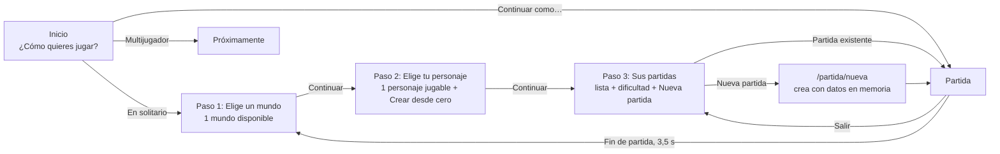
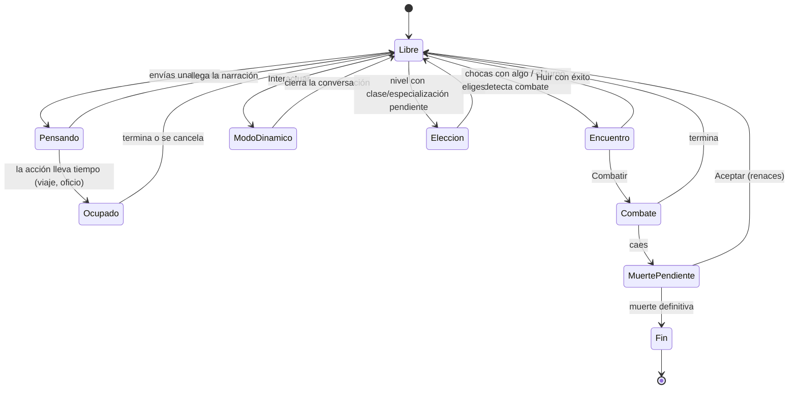

# Roadmap de front — Experiencia de usuario (flujos, orden y bloqueos)

**Creado:** 2026-10-01. Documento propio, complementario a [roadmap-front.md](roadmap-front.md)
(diseño y componentes), [roadmap-front-reino.md](roadmap-front-reino.md),
[roadmap-front-zona.md](roadmap-front-zona.md) y [roadmap-cronista.md](roadmap-cronista.md).
**Orden y hito de cada fase:** [mapa de roadmaps](21-roadmap.md#mapa-de-roadmaps).
**Revisión 2026-10-01:** incorporado lo que el Cronista añade a la experiencia (sucesos del mundo,
rumores, consecuencias, compañeros que juzgan, avance diario en segundo plano): § 4.7, § 5 y § 6.
**Qué cubre (petición de Álvaro):** **en qué orden se abren las vistas, cómo se abren, si ese orden
es correcto, y si se bloquea lo necesario mientras se ejecuta una acción** — todo lo relacionado
con la experiencia de uso, no con el aspecto.

**Fuentes revisadas:** `App.tsx` y las 6 páginas; en `GameView.tsx`, todo el estado de la partida,
`anyModalOpen`, `composerDisabled`, las pestañas deshabilitadas por estado y el orden de los ~25
overlays; los hooks de flujo (`useTurnFlow`, `useCombatFlow`, `useModoDinamico`,
`useActionModalsState`, `useTransitPolling`, `useReconnectionPolling`, `useSurroundingsPolling`,
`useInventarioAcciones`, `useMisionesAcciones`, `useZonaAcciones`); `LogPanel` y `OfferCard`;
`SelectionModalShell`, `PanelDrawer`, `SideNav`; `ZonaPanel`; `CharacterSelect` y `CharacterSaves`.

**Convenio:** identificadores `UX-n`, **🧭** decide Álvaro, **[H]** hallazgo verificado en código,
**[V]** hallazgo probable que hay que confirmar jugando, **[P]** propuesta, esfuerzo **S/M/L**.

---

## 1. Cómo es hoy

### 1.1 De abrir el juego a jugar

### 1.2 Estados de una partida

Hoy no existe un estado único: cada situación es una combinación de banderas sueltas
(`characterThinking`, `busyUntil`, `combateIniciado`, `combat.combatOpen`, `pendingDeathResolution`,
`endedAt`, `activeDynamicMode`, `pendingClaseChoice`, `kingdomFoundedInfo`, `activePanel`,
`zonaModalOpen`…). En la práctica, las situaciones reales son estas:

### 1.3 Qué se puede hacer hoy en cada estado

✅ permitido · ⛔ bloqueado · ⚠️ permitido **sin que debería** (o sin aviso)

| Estado | Escribir / barra de habilidades | Tarjetas del registro (Interactuar, Cazar, Aceptar misión…) | Rieles y paneles | Acciones dentro de paneles (equipar, tirar, construir, mercado…) | Moverse por la zona | Salir |
|---|---|---|---|---|---|---|
| Libre | ✅ | ✅ | ✅ | ✅ | ✅ | ✅ |
| Pensando (narrador escribe) | ⛔ | ⚠️ | ✅ | ⚠️ | ⚠️ (la brújula sigue) | ⚠️ (dice "progreso guardado") |
| Ocupado (viaje, oficio) | ⛔ | ⚠️ | ✅ | ⚠️ | ⚠️ (el backend lo rechaza) | ✅ |
| Encuentro (Combatir / Huir) | ⛔ | ⚠️ | ✅ | ⚠️ | ⛔ (brújula oculta) | ✅ |
| Combate | ⛔ (composer de combate) | ⚠️ | 3+3 pestañas ⛔ | ⚠️ en las que quedan | ⛔ | ⚠️ |
| Modo dinámico | ⛔ (está debajo del modal) | ⛔ (tapado) | ⛔ (tapado) | ⛔ | ⛔ | ⛔ |
| Muerte pendiente | ⛔ | ⚠️ | 4 pestañas ⛔ | ⚠️ en las que quedan | ⚠️ | ✅ |
| Elección de clase | ⚠️ ver UX-H11 | ⛔ (tapado) | ⛔ (tapado) | ⛔ | ⛔ | ⛔ |

---

## 2. Hallazgos

### 2.1 Bloqueos
| # | Hallazgo | |
|---|---|---|
| H1 | **`handleSubmit` no comprueba si ya hay un turno en curso**: solo mira viaje, fin de partida y muerte. El composer sí está deshabilitado, pero hay otras puertas que llaman a `handleSubmit` directamente: **Construir** en Reino (con el cajón abierto), **Viajar** desde una salida de zona, y los modales **Volver al campamento** y **Viajar**. El backend tiene candado (`isTurnLockedError`), así que la acción aparece en el registro y luego se retira con un aviso. | [H] |
| H2 | **Las tarjetas del registro ignoran el estado global**: `LogPanel` no tiene ningún `disabled`; cada tarjeta (`OfferCard`) solo se bloquea con su propio `busy`. Se puede pulsar *Interactuar*, *Cazar*, *Ignorar*, *Aceptar misión*, una opción de NPC, *Matar/Capturar/Clemente* o *Abrir mapa de la zona* mientras el narrador escribe, durante un viaje, con un combate pendiente o con la muerte sin resolver. | [H] |
| H3 | **Los paneles siguen operativos durante un turno o un viaje**: equipar, quitar, **tirar** objetos, crear o borrar habilidades, construir, órdenes de producción, depósito, mercado o diplomacia. Ninguno avisa, y algunos cambian datos que el turno en curso está usando (inventario, energía). | [H] |
| H4 | **Dos generaciones del narrador a la vez**: la ambientación de "El mundo" (cada 10 min) no se lanza si el personaje ya está esperando, pero **al revés no hay control**: si la ambientación está en marcha, el jugador puede enviar su acción y competir por la misma CPU/GPU, justo lo que la decisión técnica 4 quiere evitar. | [H] |
| H5 | **La brújula de moverse se puede usar mientras el narrador escribe** (solo se oculta con un modal, un panel abierto o un combate forzado), y el resultado de moverse mete entradas en el registro en mitad de otra narración. | [H] |
| H6 | **Bloqueos sin explicación**: las pestañas deshabilitadas en combate sí dicen por qué, pero la brújula **desaparece** en vez de deshabilitarse, y las tarjetas no explican nada. | [H] |

### 2.2 Orden y prioridad de lo que se abre
| # | Hallazgo | |
|---|---|---|
| H7 | **No hay gestor de capas**: unos 25 overlays condicionales en `GameView`, casi todos `fixed z-50`. Cuando coinciden dos (clase obligatoria + fundar reino, ficha de detalle + modo dinámico…), gana el que va **más abajo en el JSX**, no el más importante. | [H] |
| H8 | **Las elecciones obligatorias no esperan**: `ClaseModal` y `EspecializacionModal` solo esperan a que no haya muerte pendiente ni fin; pueden saltar encima de un combate, del modo dinámico o de la fundación del reino. | [H] |
| H9 | **Los modales importantes saltan antes de leer**: *Fundar reino* aparece en cuanto llega el resultado del turno, potencialmente antes de que el jugador lea la narración que lo explica. | [V] |
| H10 | **Un cajón abierto tapa lo que llega**: si el jugador consulta el Inventario mientras el narrador escribe, la narración, una tarjeta de oferta o un aviso de combate llegan detrás del cajón sin ninguna señal. Solo abrir el combate cierra el panel. | [H] |
| H11 | **`anyModalOpen` no incluye todos los overlays**: deja fuera el mapa de zona, Confirmar salida, Clase, Especialización y el editor de barras. El composer sigue habilitado por debajo; con el ratón no se llega, pero si conserva el foco del teclado, `Enter` podría enviar una acción detrás de un modal (Clase y Especialización no atrapan el foco). | [V] |
| H12 | **El encuentro en la zona cierra el modal de golpe** y deja al jugador en el registro (ver `roadmap-front-zona.md`, Z1/Z17). | [H] |

### 2.3 Navegación, entrada y salida
| # | Hallazgo | |
|---|---|---|
| H13 | **Cuatro pantallas para empezar** con un solo mundo y un solo personaje jugable: mundo → personaje → partidas → partida. | [H] |
| H14 | **La dificultad se elige debajo de la lista de partidas**, separada del botón *Nueva partida*, y se aplica "a tu próxima partida nueva": es fácil no verla. | [H] |
| H15 | **"Crear desde cero" está visible** aunque crear personaje propio es el hito `0.7`; hay que confirmar si funciona de punta a punta. | [V] |
| H16 | **Crear partida depende de datos en memoria** (`SessionContext`): recargar en `/partida/nueva` o un fallo al crear muestran **"No se encuentra esta partida"**, que no dice qué pasó. | [H] |
| H17 | **Fin de partida**: a los 3,5 s se va solo a *Elige un mundo* (no a *Sus partidas*, como al salir), sin dejar leer el final ni ofrecer opciones. | [H] |
| H18 | **Salir dice siempre "Tu progreso ya está guardado"**, también con un turno narrándose, un combate abierto o un viaje en curso. | [H] |
| H19 | **El botón Atrás del navegador** (o el gesto de volver) **sale de la partida sin confirmar** y no cierra primero el modal o cajón abierto, que es lo que se espera en un juego. | [H] |

### 2.4 Foco, esperas y errores
| # | Hallazgo | |
|---|---|---|
| H20 | **Foco al cerrar**: al cerrar un modal de acción el foco vuelve al composer (bien), pero al cerrar el cajón o una ficha no vuelve al botón que lo abrió. | [H] |
| H21 | **Reconexión silenciosa**: si se corta la respuesta, el front sondea cada 10 s hasta **12 minutos** (`MAX_POLL_ATTEMPTS = 72`) con la misma tarjeta de "pensando", sin decir que está reconectando ni ofrecer reintentar. | [H] |
| H22 | **Acción optimista que desaparece**: la acción del jugador se añade al registro al enviar y, si el backend la rechaza (bloqueada, candado), se quita o se sustituye; el jugador ve su texto aparecer y esfumarse. | [H] |
| H23 | **Errores tragados**: varias acciones de Reino, *Descansar en el campamento* y algunas de inventario fallan sin mensaje visible (detalle en `roadmap-front-reino.md`, R19). | [H] |
| H24 | **Confirmaciones incoherentes**: se confirma *Salir*, *Borrar partida* y *Reiniciar*, pero no **Tirar un objeto**, **Matar** a un convaleciente, **Soltar** una captura, **Sabotear** o desactivar una orden. | [H] |

---

## 3. Principios

1. **Un solo estado de partida.** Toda la interfaz deriva sus bloqueos de una única fase, no de
   banderas sueltas.
2. **Una puerta para cada efecto.** Todo lo que cambia el mundo pasa por el mismo control de "¿se
   puede ahora?", venga del composer, de una tarjeta, de un panel o del mapa.
3. **Bloquear explicando.** Nada desaparece: se deshabilita con su motivo ("El narrador está
   escribiendo").
4. **Consultar siempre, actuar con permiso.** Los paneles se pueden abrir y leer en cualquier
   momento; lo que cambia datos se bloquea cuando no toca.
5. **Una cosa importante a la vez, en orden.** Lo que llega se presenta en el orden en que se lee:
   acción → tirada → narración → efectos → ofertas → decisiones.
6. **Volver atrás funciona como en un juego.** `Esc` y Atrás cierran la capa de arriba; solo cuando
   no queda ninguna se pregunta si salir.

---

## 4. Propuestas

### 4.1 Estado único de la partida
- ~~**UX-1 · `useGamePhase`** — hook que calcula la fase actual (`libre`, `pensando`, `ocupado`,
  `encuentro`, `combate`, `dinamico`, `eleccion`, `muerte`, `fin`) a partir del estado existente,
  con prioridad fija si coinciden. Sustituye a `composerDisabled`, `anyModalOpen` y las listas de
  pestañas deshabilitadas. Tests con una tabla de casos. **M** [P]~~ ✅ 2026-10-02:
  `calcularFase` en `lib/gamePhase.ts` (prioridad fin > muerte > pensando > combate > dinámico >
  elección > encuentro > ocupado > libre) y `hooks/useGamePhase.ts`; `GameView` saca de ahí el
  bloqueo del composer, de la barra de habilidades, de la clasificación anticipada y de los botones
  que lanzan turno (`bloqueoTurno`). **Queda:** `anyModalOpen` sigue como guarda entre modales
  hasta el gestor de capas (`UX-9`); la guardia interna de `useTurnFlow` (refs) no se ha tocado.
- ~~**UX-2 · Matriz de permisos** como datos (la tabla de § 5), no como condiciones repartidas por
  el JSX: `canDo(phase, 'enviarTurno' | 'tarjeta' | 'modificarInventario' | 'moverse' | …)` devuelve
  `{ permitido, motivo }`. **M** [P]~~ ✅ 2026-10-02: `canDo(fase, accion)` en `lib/gamePhase.ts`
  con acciones `enviarTurno`, `tarjeta`, `abrirPanel`, `modificarPanel`, `moverse`, `decidir`,
  `salir`, tests de la matriz. Desviaciones de § 5 a propósito: en *Encuentro* se puede escribir y
  usar la tarjeta (el backend acepta el turno y hablar es una reacción válida; solo bloquea
  moverse). **Confirmado por la usuaria (2026-10-02)**, que pide además que responder escribiendo
  sea más accesible: `UX-37`. **Queda:** que la usen los paneles (`UX-5`), la brújula (`UX-7`), las tarjetas y el
  menú de salir (`UX-8`/`UX-18`). **Arreglado 2026-10-02** (hallazgo jugando de la usuaria): en
  combate, la tarjeta de un rival convaleciente salía con Matar/Clemente bloqueados («Estás en
  combate»); las tarjetas del combate usan ahora `bloqueoCombate` (null en la fase de combate; el
  motivo normal mientras el narrador escribe o fuera de combate).

### 4.2 Bloqueos
- ~~**UX-3 · Guardia en `handleSubmit`** — rechazar si `characterThinking` o si la fase no lo permite,
  sea cual sea la puerta (Construir, Viajar, Campamento). Los botones que lanzan un turno se
  deshabilitan igual que el composer. Resuelve H1. **S** **arreglo**~~ ✅ 2026-10-01: guardia en
  `useTurnFlow` (ref del estado + ref propia contra el doble clic) y `bloqueoTurno` con motivo en
  Construir, Viajar, Campamento y salida de zona. Lo de "si la fase no lo permite" llega con `UX-1`/`UX-2`.
- ~~**UX-4 · Tarjetas del registro con el estado global** — `OfferCard` recibe `disabled` y `motivo`
  de `canDo`. Resuelve H2. **S** **arreglo**~~ ✅ 2026-10-01: `OfferCard` recibe `bloqueo` (el
  mismo `bloqueoTurno` de UX-3, vía `LogPanel.bloqueoAcciones`) y deshabilita todas sus acciones con
  el motivo. El combate pendiente queda fuera a propósito: la tarjeta de un agresivo que te corta el
  paso es justo como se reacciona a él. Pasará a `canDo` con `UX-2`.
- ~~**UX-5 · Paneles en modo consulta** cuando la fase no permite cambios: se abren y se leen, pero
  los botones que modifican (equipar, tirar, construir, mercado…) se deshabilitan con el motivo.
  Lo que no toca el turno (renombrar una plantilla, ordenar) puede seguir libre. Resuelve H3. **M**~~ ✅ 2026-10-02:
  contexto `ModoConsulta` (`context/modoConsultaContext.ts`, `useModoConsulta`) con el motivo de
  `canDo(fase, 'modificarPanel')`; el cajón muestra «👁 Solo consulta: <motivo>». Deshabilitados con
  el motivo: capturas (depositar/soltar), repartir puntos, capturar, tamear, plantilla y equipo de
  compañero; en Reino, almacén (depositar/retirar), producción (trabajadores, órdenes), roles,
  diplomacia, mercado, campamento y «Fundar reino». Libres a propósito: grupos de combate,
  crear/borrar plantillas y el tope del almacén (solo organizan). Construir ya iba por
  `bloqueoTurno`. **Queda:** la zona (recoger, moverse) va con `UX-7`.
- ~~**UX-6 · Un narrador a la vez** — al enviar una acción con la ambientación del mundo en marcha:
  (A) esperar con el mensaje "Tu acción saldrá en cuanto el mundo termine", o (B) cancelar la
  ambientación. 🧭 Resuelve H4. **S**~~ ✅ 2026-10-02, **opción B** (decisión de la usuaria: hoy la
  ambientación «tiene peso 0» — son plantillas deterministas desde 2026-07-24, sin modelo — y no
  merece la espera). `useSurroundingsPolling` aborta la petición en curso (`AbortController`) en
  cuanto el narrador empieza a escribir el turno y descarta su resultado. **Revisar la opción A**
  cuando la ambientación gane peso con el narrador de fondo del Cronista (`CR-12`).
- ~~**UX-7 · La brújula y el mapa respetan la fase** — moverse solo en `libre`; en el resto, el botón
  sigue visible, deshabilitado y con el motivo. Resuelve H5 y H6. **S**~~ ✅ 2026-10-02: la brújula
  ya no desaparece con un encuentro pendiente; se deshabilita con el motivo de
  `canDo(fase, 'moverse')`. El mapa de zona recibe `bloqueoMovimiento`: andar y recoger del suelo
  no piden nada al backend y dejan el motivo a la vista (el mapa se sigue consultando). Sigue oculta
  bajo un modal o el cajón (lo decidirá el gestor de capas, `UX-9`).
- ~~**UX-37 · Responder escribiendo** — cuando alguien te habla o te corta el paso, contestar con
  texto libre tiene que estar a mano, no solo vía *Interactuar*. Petición de la usuaria
  (2026-10-02). **S**~~ ✅ 2026-10-02: las tarjetas de encuentro con una persona (NPC, también
  con `combateForzado`) tienen «✍️ Responder», que cierra el panel abierto, vuelve de la barra de
  habilidades al composer y escribe «Le digo a <nombre>: » con el nombre como chip y el cursor al
  final. La fauna no lo lleva. Tests en `LogPanel.test.tsx`.
- ~~**UX-8 · Bloqueos visibles** — un icono de candado y el motivo en tooltip en todo lo
  deshabilitado; en la cabecera, un indicador de la fase actual ("✒️ El narrador escribe", "🧭 De
  viaje · 12 min", "⚔️ En combate"). **S**~~ ✅ 2026-10-02: chip de fase en la cabecera
  (`etiquetaDeFase`, `lib/gamePhase.ts`: ✒️ El narrador escribe, 🧭 Ocupado · cuenta atrás, ⚠️ Te
  cortan el paso, ⚔️ En combate…; no aparece en `libre`) con el motivo en el tooltip; 🔒 en la
  brújula deshabilitada. El resto ya enseñaba candado o motivo: tarjetas del registro (`UX-4`),
  composer (texto de ayuda), botones de turno (`UX-3`) y paneles (aviso «👁 Solo consulta», `UX-5`).

### 4.3 Orden y prioridad de lo que se abre
- ~~**UX-9 · Gestor de capas con prioridad** — un `OverlayManager` con niveles fijos; dentro de un
  nivel, una sola capa; una de nivel inferior espera en cola mientras haya otra superior. Resuelve
  H7. **L**~~ ✅ 2026-10-02: `resolverCapas` (`lib/capas.ts`) y `<Capa id>` (`components/Capa.tsx`,
  contexto `CapasContext`). `GameView` registra sus 19 overlays con su nivel; solo se ve el de más
  nivel y el resto espera **oculto pero montado** (no pierde lo que tenía a medias). La ficha de
  detalle es capa «hija»: siempre encima, no hace esperar a nadie. Muerte, fin y combate no son
  capas (sustituyen al composer o al panel derecho). **Queda:** `anyModalOpen` sigue como guarda
  para no abrir un modal de acción sobre otro; que las decisiones esperen al combate/escena y a
  leer la narración es `UX-10`.

  | Nivel | Qué |
  |---|---|
  | 0 · Juego | registros, mapa, composer |
  | 1 · Consulta | cajón de paneles, fichas de detalle, mapa a pantalla completa |
  | 2 · Acción | modales de selección (recolectar, curar, comer, saquear, entregar…) |
  | 3 · Escena | modo dinámico, combate |
  | 4 · Decisión | fundar reino, clase, especialización, subida de nivel |
  | 5 · Crítico | muerte, fin de partida |
  | 6 · Sistema | menú de pausa, configuración, confirmar salida, error |

  Dónde va lo que genera el Cronista (ver § 4.7):

  | Qué | Nivel |
  |---|---|
  | Rumor, noticia, nacimiento, cambio de relación | Sin capa: notificación (`HUD-6`) + entrada en el registro |
  | Informe del amanecer (`NAR-11`) | Sin capa: tarjeta plegable en el registro |
  | Leyendas, fichas "En tu partida" | 1 · Consulta |
  | Consecuencia que exige reaccionar (vengador, emboscada) | 3 · Escena (es un encuentro) |
  | Compañero que se marcha, sucesión que pide decidir | 4 · Decisión |
  | Epílogo | 5 · Crítico |

- ~~**UX-10 · Decisiones en cola** — clase, especialización y fundación del reino **esperan** a que
  termine el combate o el modo dinámico y a que se haya leído la narración; mientras esperan, un
  aviso en la cabecera ("⚠️ Tienes una clase por elegir") permite abrirlas antes si se quiere.
  Resuelve H8 y H9. **M**~~ ✅ 2026-10-02: `hooks/useDecisionesEnCola.ts`. Esperan mientras hay
  combate, modo dinámico o narrador escribiendo, y después un tiempo de lectura de la última
  narración (`msDeLectura`: ~40 ms por carácter, entre 2 y 12 s). Mientras esperan, la cabecera
  enseña «⚠️ Tienes una clase por elegir» (o especialización, o «Tu reino espera nombre») y al
  pulsarlo se abre ya. Nota para la fase de pruebas: en esa espera el composer sigue libre.
- ~~**UX-11 · Presentación en orden del turno** — secuencia fija: acción del jugador → tirada
  (`DiceTray`) → narración → cambios de estado (vida, inventario, XP con su animación) →
  **reacciones de compañeros** (`NAR-10`) → ofertas en el registro → **sucesos del mundo que se
  acaban de saber** (rumores, informe del día) → decisiones de la cola. Cada paso espera al
  anterior. **M**~~ ✅ 2026-10-02:
  la secuencia ya era acción → tirada (los dados aterrizan antes de aplicar vida/energía en
  combate) → narración; ahora, en una entrada recién llegada, las consecuencias (misión nueva,
  ofertas, XP, reputación, oficio) entran cuando ha aterrizado la tirada (`lib/presentacionTurno.ts`,
  clase `animate-paso-turno`, sin retraso si se pide reducir el movimiento) y las decisiones
  esperan a leer la narración (`UX-10`). **Queda:** encajar en la secuencia las reacciones de
  compañeros (`NAR-10`) y los sucesos del mundo recién sabidos (Cronista, `CR-18`…`CR-20`) cuando
  existan.
- ~~**UX-12 · Qué pasa con el cajón abierto cuando llega algo** — eventos **críticos** (combate,
  muerte, encuentro agresivo) cierran el cajón con animación; los **importantes** (narración nueva,
  oferta, misión) muestran una notificación y una marca en el registro; los **menores** no
  interrumpen. Resuelve H10. **S**~~ ✅ 2026-10-02:
  `lib/llegadas.ts` clasifica lo que entra al registro con el cajón abierto: combate o alguien que te
  corta el paso → cierra el cajón; narración, oferta o misión → aviso «📜 …» dentro del cajón con
  botón «Ver» (cierra el cajón para leerlo); tu propia acción no interrumpe. La «marca en el
  registro» es la propia entrada nueva, que queda a la vista al cerrar. **Queda:** la notificación
  general fuera del cajón llega con `HUD-6`.
- ~~**UX-13 · `anyModalOpen` completo**, o mejor, sustituido por el gestor de capas: el composer
  pierde el foco y se deshabilita con cualquier capa ≥ 1 abierta. Resuelve H11. **S** **arreglo**~~
  ✅ 2026-10-01: el composer cuenta también el mapa de zona, Confirmar salida, Clase,
  Especialización, el editor de barras y el detalle de recurso, y `ChatComposer` suelta el foco al
  deshabilitarse. El cajón de paneles queda fuera (la Enciclopedia inserta chips en el composer);
  lo decidirá el gestor de capas de `UX-9`.
- **UX-14 · Encuentros sin cortes** — con el mapa fuera del modal (`roadmap-front-zona.md`, ZON-1),
  el encuentro aparece sobre la ficha y en el registro sin cerrar nada. Resuelve H12.

### 4.4 Entrada y salida
- **UX-15 · Inicio con *Continuar* y *Nueva partida*** — *Continuar* (la última partida) como botón
  principal; *Nueva partida* abre un **asistente en una sola pantalla**: mundo, personaje,
  dificultad y nombre de la partida, con resumen y un botón *Empezar*. Los pasos con una sola
  opción vienen ya elegidos y plegados, sin desaparecer. Resuelve H13 y H14. **M**
- ~~**UX-16 · El asistente sobrevive a recargar** — su estado va en la URL o en `sessionStorage`; un
  fallo al crear dice "No se pudo crear la partida" con *Reintentar*. Resuelve H16. **S**
  **arreglo**~~ ✅ 2026-10-01: `SessionProvider` guarda mundo, personaje y dificultad en
  `sessionStorage`; `GameView` distingue "No se pudo crear la partida" (con *Reintentar*) de "Se ha
  perdido la elección" en vez del genérico "No se encuentra esta partida".
- **UX-17 · "Crear desde cero"** oculto o marcado "Próximamente" hasta el hito `0.7`, si se
  confirma que no está listo. 🧭 Resuelve H15. **S**
- **UX-18 · Epílogo de fin de partida** — pantalla de cierre con el último texto, un resumen (días,
  nivel, muertes, logros) y botones *Ver el diario* · *Volver a tus partidas* · *Nueva partida*.
  Sin redirección automática. Resuelve H17. **M**
- **UX-19 · Salir según el contexto** — el mensaje cambia si hay un turno en curso ("El narrador
  todavía está escribiendo; si sales ahora, lo verás al volver"), un combate o un viaje. Se integra
  en el menú de pausa (`CFG-3`). Resuelve H18. **S**
- **UX-20 · Atrás = cerrar la capa de arriba** — cada capa abierta empuja una entrada de historial;
  Atrás o `Esc` la cierran; sin capas, Atrás abre el menú de pausa en vez de salir. Resuelve H19.
  **M**

### 4.5 Foco, esperas y errores
- **UX-21 · Foco** — toda capa recibe el foco al abrirse (en la acción segura: *Cancelar* en lo
  irreversible) y lo devuelve al elemento que la abrió al cerrarse. Resuelve H20. **S**
- **UX-22 · Esperas con nombre** — la tarjeta de espera dice qué pasa: "escribiendo", "tarda más de
  lo normal" (pasados 30 s), "reconectando (intento 3)" y, al cabo de un rato, botones *Seguir
  esperando* y *Volver a intentar*. Resuelve H21. **S**
- **UX-23 · Acciones que no se esfuman** — una acción rechazada se queda en el registro tachada,
  con el motivo y un botón *Volver a escribirla* que la devuelve al composer. Resuelve H22. **S**
- ~~**UX-24 · Ningún error en silencio** — `ErrorBanner` común con *Reintentar* en toda acción que
  llame al backend. Resuelve H23. **S** **arreglo**~~ ✅ 2026-10-01: `ErrorBanner` +
  `useErrorConReintento` en todas las acciones de Reino (Súbditos, Producción, Mercado; cierra
  también `REI-111`) y en borrar/reiniciar/renombrar partida (adiós `window.alert`); Descansar en el
  campamento enseña el fallo en su `ConfirmModal` (nuevo prop `error`, botón *Reintentar*).
  Inventario ya lo hacía (`DetailModal`).
- **UX-25 · Confirmar o deshacer, con criterio** — lo irreversible (Matar, Soltar captura, Sabotear,
  Borrar partida) se confirma; lo que se puede revertir (Tirar un objeto, Desactivar una orden,
  Retirar del almacén) se hace al momento con una notificación de **Deshacer** durante 5 s. Ajuste
  `CFG-32` para quien prefiera confirmarlo todo. Resuelve H24. **M**

### 4.6 Ayudas al jugador
- **UX-26 · Primeros pasos** — en la primera partida, indicaciones breves y una sola vez: dónde
  está el mapa, cómo se escribe una acción, para qué sirven los rieles. Se pueden saltar y volver a
  ver desde Configuración. **M**
- **UX-27 · Lectura sin saltos** — si el jugador está leyendo más arriba, las entradas nuevas no
  le mueven el scroll; aparece una píldora "3 entradas nuevas ↓". Se recuerda la posición de lectura
  de cada registro al cambiar de vista. **S**
- **UX-28 · Mismo gesto para lo mismo** — todo se cierra con `Esc`, ✕ y clic fuera (salvo
  formularios a medias y decisiones obligatorias); todo panel se abre y se cierra con su misma
  pestaña o su tecla. **S**

### 4.7 El mundo vivo (Cronista)
El Cronista (`roadmap-cronista.md`) hace que pasen cosas sin que el jugador actúe y que lo que hizo
vuelva más tarde. Eso exige estas reglas de experiencia:

- **UX-29 · El mundo de fondo nunca bloquea** — el avance diario, el Escriba, el Árbitro y el
  Cronista corren con menos prioridad que el turno y **no cambian la fase** de la partida
  (`useGamePhase`); solo encienden el indicador "El mundo avanza" (`HUD-12`). Si el jugador envía una
  acción, su turno pasa delante (cola con prioridades, Cronista § 13.2). **S**
- **UX-30 · Solo lo que el personaje sabe** — ninguna pantalla (Leyendas, Enciclopedia, Reputación,
  Diplomacia, mapa, notificaciones) muestra un suceso que el personaje no conoce; todas leen del
  mismo filtro de conocimiento del backend. Un suceso a medio saber se presenta como rumor. **S**
- **UX-31 · Varios días de golpe** — tras un viaje o descanso largo, los sucesos que se han sabido
  durante esos días llegan **juntos**: una notificación resumen y una tarjeta "Mientras viajabas…"
  en el registro, nunca una ráfaga de avisos. **S**
- **UX-32 · Consecuencias como encuentros** — una consecuencia aplazada que aparece en escena
  (alguien que vuelve) entra por el mismo flujo que un encuentro de zona (fase *Encuentro*, tirada
  de quién ve a quién, oferta en el registro y sobre la ficha), con un sello "te conoce"
  (`INT-8`). **S**
- **UX-33 · Avisos de compañeros con margen** — un compañero que va a marcharse avisa con 3 días
  ficticios (registro + panel Compañeros); la marcha llega como capa de *Decisión* (despedida, y si
  procede, intentar convencerle), nunca como desaparición silenciosa. **S**
- **UX-34 · Sin deshacer para el mundo** — el *Deshacer* de `UX-25` solo vale para acciones de
  gestión del jugador (tirar, retirar…); lo que cambia la historia (matar, perdonar, prometer) no se
  deshace. 🧭 ¿Avisar antes de actos de mucho peso (matar a un líder)? Por defecto **no** — como en
  Baldur's Gate 3, la consecuencia es parte del juego. **S**
- **UX-35 · El turno no espera al día** — al cruzar un día ficticio, el avance diario se ejecuta
  **después** de devolver la narración del turno; sus resultados llegan en el siguiente refresco
  (notificación o informe del amanecer), sin alargar el turno. **S**
- **UX-36 · Leyendas siempre a una tecla** — atajo `Y` (se añade a la lista de `CFG-26`; `L` sigue
  siendo la Enciclopedia y `Q`/`E` el cambio de panel de `PAN-1`) y enlace desde cada notificación
  y rumor a su entrada. **S**
- ~~**UX-38 · Noticias del mundo que se pueden tocar** (usuaria, 2026-10-04, al dar valor al canal
  «El mundo» en `CR-12`) — cada entrada del canal lleva icono de categoría (guerra, comercio,
  naturaleza, tu Reino); los nombres de facciones, lugares y NPC son enlaces a su ficha o a su sitio
  en el mapa; y si la noticia abre una oportunidad (`CR-12` paso 12d), una etiqueta con distancia y
  plazo («a 6 h de ti · quedan 2 días»). Filtrar por categoría, más adelante. **S**~~ ✅ 2026-10-04:
  `LogEntry.noticia` (migración `20261004230000_noticia_log`) con categoría, oportunidad y resumen;
  `NoticiaMundo.tsx` pinta el icono (⚔️ conflicto, 🐪 comercio, 🌿 naturaleza, 🏰 tu Reino), la
  etiqueta «📍 En {lugar} · hasta el día N» y el resumen «Mientras pasaban los días…» plegado (`UX-31`
  en el registro). Los enlaces a la ficha ya existían (`EnciclopediaLinkedText`). Lo pendiente pasa a
  `UX-39`.
- **UX-39 · Noticias del mundo, segunda parte** (lo que quedó de `UX-38`, 2026-10-04) — distancia
  en la etiqueta de la oportunidad («a 6 h de ti», según dónde esté el personaje en cada momento),
  enlace del lugar a su sitio en el mapa, filtro del canal por categoría, y categoría también para
  las noticias que no salen del narrador de fondo (expediciones, agenda Serhu). **S**

---

## 5. Matriz de permisos propuesta

✅ permitido · 👁 solo consulta · ⏳ en cola (se hace al terminar) · ⛔ bloqueado con motivo

| Fase | Escribir y barra | Tarjetas del registro | Abrir paneles | Cambiar datos en paneles | Moverse | Decisiones (clase, reino) | Menú / salir |
|---|---|---|---|---|---|---|---|
| Libre | ✅ | ✅ | ✅ | ✅ | ✅ | ✅ | ✅ |
| Pensando | ⛔ | ⛔ | ✅ | 👁 | ⛔ | ⏳ | ✅ (aviso) |
| Ocupado | ⛔ (salvo *Cancelar acción*) | ⛔ | ✅ | 👁 | ⛔ | ⏳ | ✅ |
| Encuentro | ⛔ (salvo *Combatir / Huir*) | solo la del encuentro | ✅ | 👁 | ⛔ | ⏳ | ✅ |
| Combate | composer de combate | solo las del combate | las de combate | 👁 | ⛔ | ⏳ | ✅ (aviso) |
| Modo dinámico | ⛔ | ⛔ | ⛔ | ⛔ | ⛔ | ⏳ | ✅ |
| Elección | ⛔ | ⛔ | ✅ (Enciclopedia) | ⛔ | ⛔ | la propia | ✅ |
| Muerte pendiente | ⛔ (salvo *Aceptar*) | ⛔ | 👁 | ⛔ | ⛔ | ⏳ | ✅ |
| Fin | ⛔ | ⛔ | 👁 (Diario) | ⛔ | ⛔ | ⛔ | ✅ |

**Mundo de fondo** (avance diario, Cronista): no es una fila de la matriz porque **no es una fase**;
mientras corre, todo se comporta según la fase real (`UX-29`).

🧭 Revisar con Álvaro las casillas dudosas: si en *Pensando* debe poderse equipar algo (hoy se
puede), y si en *Combate* se debe poder abrir Enciclopedia/Habilidades (hoy sí).

---

## 6. Cómo comprobarlo (escenarios de prueba)

Cada escenario se juega antes y después; varios se pueden automatizar con Playwright o con tests
del hook `useGamePhase`.

1. Envía una acción y, mientras el narrador escribe, pulsa **Construir** en Reino → no debe salir
   un segundo turno.
2. Mientras escribe, pulsa **Interactuar** o **Aceptar misión** en una tarjeta antigua → bloqueado
   con motivo.
3. Mientras escribe, abre Inventario y **tira** un objeto → solo consulta.
4. Espera a la ambientación de "El mundo" y envía una acción en ese momento → no deben correr dos
   generaciones a la vez.
5. Sube a un nivel con clase pendiente **dentro de un combate** → la elección espera al final.
6. Funda el reino → la narración se lee antes de que salga el modal.
7. Con el Inventario abierto, que te ataque un agresivo → el cajón se cierra y se ve el combate.
8. Pulsa **Atrás** con un modal abierto, luego con el cajón abierto, luego sin nada → cierra modal,
   cierra cajón, abre el menú de pausa.
9. Recarga en `/solitario/partida/nueva` → el asistente sigue donde estaba.
10. Muere definitivamente → epílogo sin redirección.
11. Corta la red durante un turno → la tarjeta dice "reconectando" y ofrece reintentar.
12. Tira un objeto → aparece *Deshacer* y funciona.
13. Una partida completa solo con teclado (y con mando en la Steam Deck).
14. Cruza un día ficticio con el Cronista activo → el turno llega igual de rápido; el informe del
    día aparece después (`UX-35`).
15. Viaja varios días → una sola notificación resumen y una tarjeta "Mientras viajabas…" (`UX-31`).
16. Un suceso lejano que el personaje no sabe → no aparece en ninguna pantalla hasta que llega como
    rumor (`UX-30`).
17. Perdona a un NPC y vuelve a cruzártelo días después → entra como encuentro con sello "te
    conoce" (`UX-32`).
18. Contraría a un compañero varias veces → aviso con margen y despedida como decisión (`UX-33`).
19. Envía una acción mientras el Cronista escribe → tu turno pasa delante (`UX-29`).

---

## 7. Orden recomendado

| Fase | Contenido | Por qué |
|---|---|---|
| **UX-A · Arreglos** | UX-3, UX-4, UX-13, UX-16, UX-24 | Evitan dobles turnos, acciones fuera de tiempo y errores invisibles. Pequeños y encajan en el hito `0.1`. |
| **UX-B · Estado único** | UX-1, UX-2, UX-5, UX-7, UX-8, UX-37 | La base para que todos los bloqueos sean coherentes y se expliquen. |
| **UX-C · Orden** | UX-9, UX-10, UX-11, UX-12 | Una cosa importante a la vez y en el orden en que se lee. |
| **UX-D · Entrada y salida** | UX-15, UX-17, UX-18, UX-19, UX-20 | Empezar más rápido, salir sin sustos, Atrás como en un juego. |
| **UX-E · Pulido** | UX-6, UX-21, UX-22, UX-23, UX-25…28 | Foco, esperas, deshacer, primeros pasos. |
| **UX-F · Mundo vivo** | UX-29…UX-36, UX-38, UX-39 | Llega con las fases 3-5 del Cronista (hitos `0.2`-`0.3`); `UX-29` y `UX-35` antes de que el Cronista use la IA. |

El hito exacto de cada fase lo fija el [mapa de roadmaps](21-roadmap.md#qué-entra-en-cada-hito).

## 8. Decisiones pendientes 🧭

1. Esperar o cancelar la ambientación del mundo cuando el jugador actúa. (UX-6)
2. Qué se permite en *Pensando* y en *Combate* (matriz § 5).
3. Si las decisiones obligatorias pueden abrirse antes de tiempo desde el aviso. (UX-10)
4. Asistente de nueva partida en una sola pantalla. (UX-15)
5. Ocultar "Crear desde cero" hasta el hito `0.7`. (UX-17)
6. Atrás sin capas abiertas: menú de pausa o salir. (UX-20)
7. Qué acciones se confirman y cuáles se deshacen. (UX-25)
8. Avisar o no antes de actos de mucho peso, como matar a un líder. (UX-34)
