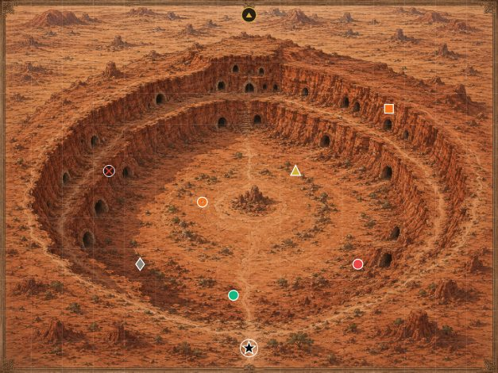
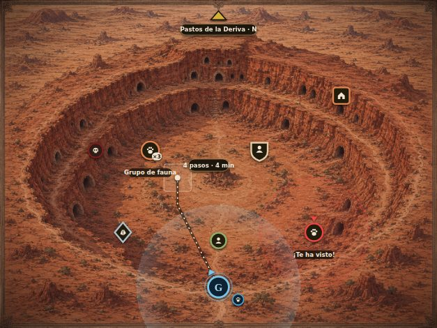

# Roadmap de front — Mapa de zona

**Creado:** 2026-10-01. Documento propio, complementario a [roadmap-front.md](roadmap-front.md)
(donde la zona solo aparece en `MOD-17`, `ATM-7` y `PAN-8`) y a
[roadmap-front-reino.md](roadmap-front-reino.md).
**Por qué un documento aparte (Álvaro, 2026-10-01):** el mapa de zona, donde el personaje se mueve,
es **la sección que más se va a usar**, así que tiene que ser la más accesible y la que mejor se vea
y funcione. Desde las fases 1-5 del plan de mecánicas por zona, *lo que ocurre en un punto del mapa
se hace desde el mapa* (`docs/mecanicas/20-zona-cuadricula-interactuar.md`).

**Fuentes revisadas:**
- Front: `ZonaPanel.tsx` (897 líneas), `ZonaMovimientoModal`, `ZonePointDetailModal`,
  `ZoneGroupDetailModal`, `ZonaSalidaModal`, `ParcelaDetailModal`, `MapaPanel` (pestaña Zona), el
  botón 🧭 de `GameView.tsx`, `lib/rumboSalida.ts`, tipos de `lib/api.ts`.
- Backend (para saber qué datos hay): `services/zonaPosicion.ts`, `services/zonePoints.ts`,
  `services/movementTemplates.ts`, `routes/saves/zona.ts`, `lib/imageAssets.ts`
  (`zoneMapImageUrl`) y las 7 ilustraciones de zona de `backend/uploads/images/zona/`.
- Prueba visual: los iconos actuales y la propuesta, dibujados sobre la ilustración real de *La
  Hondonada del Eco* a la escala de la Steam Deck (§ 1.2 y § 5).
- Referencias de otros juegos (§ 3, fuentes al final).

**Convenio:** identificadores `ZON-n`, **🧭** decide Álvaro, **[H]** hallazgo verificado,
**[P]** propuesta, esfuerzo **S/M/L**. Columna **Back**: ✅ solo front · 🔌 exponer un dato que el
backend ya tiene · 🛠️ lógica nueva en backend. Mismas restricciones que el roadmap general:
escritorio y Steam Deck (1280×800), GPU modesta, recursos empaquetados, `prefers-reduced-motion`.
**Hito de cada fase:** [mapa de roadmaps](21-roadmap.md#qué-entra-en-cada-hito) (Z-A en `0.1`, Z-B…Z-D
en `0.2`, Z-E en `0.4`, Z-F en `0.5`). **Con el Cronista** (`roadmap-cronista.md`): las fichas que
vienen de una consecuencia aplazada llevan sello "te conoce" y los NPC con recuerdo muy negativo
anillo de némesis (`INT-6`, `INT-8` del roadmap de front); la hostilidad que pide `ZON-50` sale del
mismo estado por partida que el Cronista crea.

---

## 1. Cómo es hoy

### 1.1 Funcionamiento
- **Lienzo** de 800×600 dividido en 16×12 celdas de 50 px (≈ 50 m por celda), con la ilustración
  de la zona de fondo. El backend ya busca variantes de la ilustración por **momento del día y
  estación** (`zoneMapImageUrl(slug, momento, estacion)`); hoy hay 7 ilustraciones, sin variantes.
- **Dos sitios** donde se ve: el modal **"Moverte por la zona"** (botón 🧭 flotante entre los dos
  registros, 90 % de la pantalla) y la pestaña **Mapa → Zona**, que es solo de consulta.
- **Moverse**: clic en una celda → el backend calcula la línea recta (Bresenham) y avanza **un paso
  por petición**; el front anima 600 ms y vuelve a pedir. Cada paso = 1 minuto de ficción; el
  mundo da un paso a la vez (fauna y NPC pasean, siguen rutas o persiguen).
- **Encuentros**: misma celda = colisión; celda adyacente = aviso y oferta de Interactuar; un
  agresivo a **2 celdas** (`RADIO_PERSECUCION_CELDAS`) persigue. Al haber encuentro, el modal se
  cierra y la tarjeta aparece en el registro.
- **Iconos**: forma por categoría (círculo fauna, triángulo NPC, cuadrado edificio, rombo recurso,
  aspa cadáver, rombo gris objeto), relleno de color por reputación (verde, dorado, rojo, naranja,
  gris), número dentro si es un grupo; jugador = estrella negra; salida = círculo con flecha dorada;
  parcela = cuadrado con cruz.
- **Al lado del mapa**: control regional en texto, mensaje del último movimiento, leyenda plegable,
  y la lista de puntos repetida en texto.

### 1.2 Cómo se ve a escala de la Steam Deck

*Iconos actuales reproducidos con su mismo SVG sobre la ilustración real, al tamaño que ocupa el
mapa en el modal en una pantalla de 800 px de alto.*

---

## 2. Hallazgos verificados **[H]**

### 2.1 Acceso
| # | Hallazgo |
|---|---|
| Z1 | **Para moverse hay que abrir un modal que tapa la partida**: mientras caminas no ves la narración ni el registro, y el modal se cierra solo al haber un encuentro, con un corte brusco. |
| Z2 | **El botón 🧭 desaparece** con cualquier panel o modal abierto, con un combate pendiente, y por debajo de 1024 px de ancho (`hidden lg:flex`). Es la acción más usada y es la más escondida. |
| Z3 | **Dos mapas distintos para lo mismo**: el de moverse (modal) y el de consultar (Mapa → Zona, con el aviso "usa el icono 🧭 para moverte de verdad"). |
| Z4 | **Sin tecla**: no hay atajo para abrir el mapa ni para moverse; solo `Escape` para cerrar el modal. |
| Z5 | **El mapa no existe mientras está cerrado**: se pide (`getZona`) al abrir. No hay minimapa ni ninguna referencia espacial permanente en pantalla. |

### 2.2 Legibilidad
| # | Hallazgo |
|---|---|
| Z6 | **Contraste**: los rellenos dorado (`NEUTRO`), naranja (`SIN_FACCION`) y rojo (`ENEMIGO`) se confunden con las ilustraciones, que son de tierra roja y ocre (ver § 1.2). Las salidas también son doradas sobre ocre. |
| Z7 | **Tamaño**: los iconos miden 14-20 unidades del lienzo; a la escala de la Steam Deck quedan en **~10 px**, por debajo del mínimo recomendado para iconos de mapa (~11 px legibles, más para tocar o apuntar con mando). |
| Z8 | **El número del grupo no se lee** (texto de 9 unidades dentro de un círculo de 8 de radio). |
| Z9 | **Formas sin contenido**: un círculo naranja no dice si es un lobo o una cabra; no hay pictograma, retrato ni nombre visible. El nombre solo sale en el `<title>` nativo del navegador (con retardo y sin estilo). |
| Z10 | **El jugador es una estrella negra**: no se distingue de un vistazo, no dice hacia dónde mira, y los compañeros que viajan con él no aparecen. |
| Z11 | **La cuadrícula** (blanco al 12 %) no se ve sobre terreno claro y, cuando se ve, ensucia la ilustración. |
| Z12 | **Colores sueltos**: `COLOR_HEX` usa hexes propios (`#10b981`, `#f97316`…) fuera de los tokens del juego. |

### 2.3 Movimiento
| # | Hallazgo |
|---|---|
| Z13 | **No hay previsualización**: ni celda resaltada al pasar el ratón, ni ruta, ni destino marcado, ni coste ("8 pasos · 8 min"). El backend devuelve `caminoRestante` en cada paso y el front no lo dibuja. |
| Z14 | **El movimiento es lento y rígido**: 600 ms por celda con interpolación `linear`, más el tiempo de una petición HTTP por paso; un cruce de mapa de 15 celdas tarda más de 9 s sin forma de acelerar. |
| Z15 | **No se puede parar** salvo haciendo clic en otro destino. |
| Z16 | **La línea recta ignora el terreno**: el camino atraviesa los acantilados de la ilustración, porque el motor no tiene capa de terreno (no es fallo del front, pero el front debería al menos enseñarlo). |
| Z17 | **Feedback de encuentro en texto**: "Te topas con X." en una línea al lado del mapa, y el modal se cierra. |

### 2.4 Información
| # | Hallazgo |
|---|---|
| Z18 | **No se ve el peligro antes de tiempo**: el radio de persecución (2 celdas) y el de interacción (`RADIO_INTERACCION_PX` = 100 px) no se dibujan; el jugador descubre que algo es agresivo cuando ya le persigue. El backend tampoco manda si un punto es hostil (el color es de reputación, no de temperamento). |
| Z19 | **No se ve el paso del tiempo**: hay fauna diurna y nocturna, y el motor ya pide la ilustración por momento del día, pero el mapa se ve igual a mediodía que a medianoche. |
| Z20 | **No se ven las rutas** de los NPC que patrullan (`ruta`, `movementTemplates.ts`). |
| Z21 | **"???" sin forma propia**: lo no descubierto se pinta igual que lo conocido, con el nombre cambiado. |
| Z22 | **El control regional es una línea de texto** sobre el mapa. |
| Z23 | **Hacer clic en un punto abre un modal entero** (`SelectionModalShell`) para leer tres chips y elegir *Ir hasta aquí* o *Ver en la Enciclopedia*; no hay imagen ni retrato. |
| Z24 | **No hay zoom** ni desplazamiento: el lienzo se encoge al tamaño disponible. |
| Z25 | **Lista de texto duplicada**: los mismos puntos aparecen en el mapa y en una lista larga al lado, sin agrupar ni ordenar por distancia. |

---

## 3. Qué hacen otros juegos

| Juego | Qué hace bien | Qué tomamos |
|---|---|---|
| **Foundry VTT / Roll20** (mesas virtuales de rol) | Cada criatura es una **ficha** redonda con su imagen y un **anillo de color por disposición**: amistoso, neutral u hostil. | El lenguaje de **ficha de mesa** encaja con el "como en D&D" que ya guía las tiradas. Anillo de color en vez de relleno. |
| **Heroes of Might and Magic** | Al elegir destino dibuja una **línea de flechas** hasta él; verde lo que se alcanza este turno, rojo lo que se queda para el siguiente. | Ruta prevista con **coste visible** y color según si se llega o no (energía, noche, peligro). |
| **Divinity: Original Sin 2** | Al pasar el ratón muestra la **ruta, la distancia y el coste** en puntos de acción antes de mover. | Previsualización al pasar el ratón, sin hacer clic. |
| **XCOM 2** | Contorno de alcance de movimiento y **iconos de aviso en las casillas** de la ruta (romper sigilo, peligro). | Marcar en la ruta las celdas que te ponen a la vista de un agresivo. |
| **Into the Breach** | **Telegrafía la intención del enemigo** antes de que actúe: el jugador decide con toda la información. | Dibujar el **radio de amenaza** de los agresivos y su intención ("¡te ha visto!") antes de la colisión. |
| **Shadow Tactics / Desperados III** | **Conos de visión** que se muestran al pasar el ratón o con clic derecho, con colores por estado (tranquilo, sospecha, alarma). | Radio de detección a la vista al pasar el ratón por un agresivo, con estado. |
| **Mount & Blade II** | El mapa de campaña se mueve en tiempo continuo con **velocidad ×1 / ×2 / pausa**; doble clic = ir más rápido. Es justo el modelo que cita el propio motor de zona ("estilo Mount & Blade"). | Velocidad de movimiento elegible, doble clic para ir rápido, pausa. |
| **Battle Brothers** | Niebla de guerra con un **círculo de visión** alrededor del grupo; el terreno cambia la detección. | Círculo de visión del personaje y niebla suave fuera de él (opcional). |
| **Darkest Dungeon** | El mapa distingue **sin explorar, explorado y limpio** con tres tratamientos visuales; la luz cambia lo que ves. | Estados visuales para "???", conocido y agotado. |
| **Old School RuneScape** | Clic en el minimapa para andar; una **bandera roja** marca el destino. | Minimapa siempre visible y que se pueda usar para moverse; bandera de destino. |
| **Baldur's Gate 3** | **Leyenda** en una esquina, tooltip al pasar el ratón con el nombre, y **marcas propias** con nombre. | Leyenda compacta, tarjeta al pasar el ratón y marcas del jugador. |
| **The Banner Saga** | Sobre ilustraciones a mano, la interfaz es **plana y sencilla** para no competir con el arte; el viaje se ve como una **caravana animada**. | Fichas sobrias encima de la ilustración; el personaje y sus compañeros se mueven como grupo. |
| **Ghost of Tsushima** | El *viento guía* señala el objetivo **dentro del mundo**, sin flechas de HUD. | Indicación de la misión seguida como un rastro sutil dentro del mapa, no una flecha encima. |
| **Slay the Spire** | Nodos unidos por **líneas de puntos** que se recorren animadas. | Ruta de puntos que "se dibuja" al confirmar. |

---

## 4. Visión: **el tablero de mesa**

La zona se convierte en un **tablero de juego de rol de mesa**: la ilustración es el mapa del
máster y todo lo que se mueve encima es una **ficha** sobria, legible sobre cualquier fondo, con su
pictograma y un anillo que dice cómo se lleva contigo. Encaja con la identidad del proyecto
(tiradas "como en D&D", madera y hierro de taberna) y resuelve la legibilidad sobre ilustraciones
de cualquier color.

Principios:
1. **Siempre a mano.** El mapa es la herramienta principal: visible o a una tecla de distancia, sin
   tapar la narración.
2. **Leer antes de actuar.** Ruta, coste, peligro y visión se ven antes de hacer clic (Heroes,
   Divinity, Into the Breach).
3. **La ilustración manda, las fichas no compiten** (The Banner Saga): placas oscuras pequeñas,
   sombra suave, nada de colores chillones sobre el arte.
4. **Todo responde.** Pasar el ratón, hacer clic, moverse, encontrarse con algo: cada acción tiene
   una respuesta visual inmediata, aunque el backend tarde.
5. **Barato de pintar.** SVG, `transform`/`opacity`, sin filtros en bucle, sin WebGL; todo lo
   ambiental, desactivable.

---

## 5. Propuesta visual

*Maqueta sobre la misma ilustración y al mismo tamaño que § 1.2: fichas con pictograma y anillo de
disposición, nombre bajo el grupo cercano, ruta de puntos con destino y coste ("4 pasos · 4 min"),
celda bajo el cursor resaltada, círculo de visión del personaje, radio de amenaza del agresivo con
aviso "¡Te ha visto!", ficha del personaje con su inicial, anillo de cristal y dirección, compañero
que le sigue, salida con su nombre y rumbo, y un leve tinte de atardecer con viñeta. Los nombres
son de relleno.*

---

## 6. Acceso y disposición (`ZON-A`)

| Id | Propuesta | Back | Esf. |
|---|---|---|---|
| ZON-1 | **El mapa vive en la pantalla de juego, no en un modal** 🧭. Tres opciones: **(A, recomendada)** la columna derecha muestra por defecto la **Zona**, con *El mundo* y *Reino* como pestañas con contador de entradas nuevas — igual que ya se sustituye por el panel de combate durante una pelea; la narración del personaje sigue visible a la izquierda mientras te mueves. **(B)** minimapa fijo encima del registro de personaje, ampliable. **(C)** mantener el modal, pero más pequeño y sin tapar el registro. | ✅ | L |
| ZON-2 | **Minimapa permanente** (si no se elige A): esquina de la cabecera o del registro, ~200 px, con el personaje centrado, los puntos cercanos y **clic para andar** (OSRS). | ✅ | M |
| ZON-3 | **Un solo mapa**: la vista de consulta de *Mapa → Zona* pasa a ser la misma vista, con el movimiento activo. | ✅ | S |
| ZON-4 | **Atajos**: `M` abre o centra el mapa, `Z` alterna mapa grande / minimapa, flechas o `WASD` mueven una celda, `Espacio` para o reanuda, `Tab` recorre los puntos cercanos, `Enter` interactúa con el seleccionado. Mando: cruceta = celda, A = confirmar, B = parar. | ✅ | M |
| ~~ZON-5~~ ✅ 2026-10-05 (adelantada de Z-C a petición de la usuaria: chocar con algo ya no cierra el mapa de movimiento; la tarjeta del encuentro sale junto a su ficha con sus acciones —las mismas del registro, `lib/ofertaModoDinamico.ts`— más «Seguir mi camino»; hablar o recolectar se abren encima y el mapa vuelve; solo se cierra para escribir una respuesta o al empezar un combate. Lo de «con el mapa en la pantalla de juego» sigue esperando `ZON-1`) | **El encuentro no cierra nada**: con el mapa en la pantalla de juego, la tarjeta de Interactuar aparece en el registro de al lado y además **sobre la ficha** del encuentro en el mapa (ver ZON-41). | ✅ | S |
| ZON-6 | **Pantalla completa del mapa** (`F` o doble clic en el borde) para explorar con detalle. | ✅ | S |

## 7. Fichas e iconos (`ZON-I`)

| Id | Propuesta | Back | Esf. |
|---|---|---|---|
| ~~ZON-10~~ | ~~**Fichas con placa oscura + pictograma + anillo de disposición** (Foundry VTT). La placa conserva la **forma por categoría** ya decidida (círculo fauna, escudo NPC, cuadrado edificio, rombo recurso) para no romper lo aprendido; dentro, un **pictograma SVG** claro (huella, busto, casa, mineral, calavera, saco); el color pasa del relleno al **anillo**, y los colores salen de los tokens del juego (`moss`, `wood-200`, `danger`, `cost`, `accent2`). Sombra suave para separarla de la ilustración. Resuelve Z6, Z9, Z12.~~ ✅ 2026-10-02: `zona/FichaZona.tsx` (placa oscura con la forma de su categoría, pictograma SVG —huella, busto, casa, cristal, saco, calavera— y anillo de color con tokens `moss`/`wood-200`/`danger`/`cost`/`accent2`, sombra suave). | ✅ | M |
| ~~ZON-11~~ | ~~**Tamaño mínimo garantizado**: las fichas se dibujan a tamaño de pantalla fijo (~28 px de diámetro) sea cual sea la escala del lienzo, con área de clic de 40 px. Resuelve Z7.~~ ✅ 2026-10-02: ~28 px de pantalla a cualquier tamaño de mapa (`useEscalaPantalla`, `lib/zonaFichas.ts`) y área de clic de 40 px. | ✅ | S |
| ZON-12 | **Pictograma por especie o NPC** cuando haya icono o miniatura en la Enciclopedia (las fichas de fauna y NPC ya tienen `thumbnail`): retrato recortado en la ficha, como en una mesa virtual; pictograma genérico si no hay. | ✅ | M |
| ~~ZON-13~~ | ~~**Grupos legibles**: insignia "×3" en píldora clara fuera de la ficha; a partir de 3, fichas ligeramente apiladas para que se vea "varios". Resuelve Z8.~~ ✅ 2026-10-02: píldora clara "×N" fuera de la ficha; desde 3, dos placas apiladas detrás. | ✅ | S |
| ~~ZON-14~~ | ~~**Ficha del personaje**: retrato o inicial, anillo de cristal `accent` (el color de "tu personaje" en todo el juego), **flecha de dirección** según el último paso y halo suave que respira cuando está quieto. Resuelve Z10.~~ ✅ 2026-10-02: `FichaJugador` — placa con silueta, anillo de cristal `accent`, flecha según el último paso y halo que respira quieto (`animate-pulse-slow`, se apaga con «reducir movimiento»). **Pendiente:** retrato o inicial del personaje (el mapa no recibe el nombre; hoy silueta) y compañeros que viajan con él (Z10). | ✅ | S |
| ZON-15 | **Compañeros que siguen al personaje** como fichas pequeñas detrás de él (Banner Saga), con su estado de salud en el anillo. | 🔌 (compañeros que viajan) | M |
| ~~ZON-16~~ ✅ 2026-10-05 (silueta con «?» y anillo punteado si no está descubierto; atenuada con ⏳ si está agotada; también en la tarjeta) | **Estados de descubrimiento** (Darkest Dungeon): no descubierto = ficha en silueta con "?" y anillo punteado; conocido = normal; agotado/en enfriamiento = ficha atenuada con reloj. Resuelve Z21. | ✅ / 🔌 (enfriamiento) | S |
| ~~ZON-17~~ | ~~**Salidas como estandartes de camino**: flecha grande hacia el borde, placa con el nombre (o "Camino hacia el norte" si no se ha visitado) y el tiempo de viaje si se conoce; atenuada si está lejos.~~ ✅ 2026-10-02: `EstandarteSalida` — placa con doble flecha hacia el borde y etiqueta con el destino (o «Camino hacia el …») que crece hacia el interior; atenuada si no está al alcance. **Pendiente:** tiempo de viaje en la etiqueta — `ZonaSalidaInfo` no lo trae (🔌). | ✅ | S |
| ~~ZON-18~~ ✅ 2026-10-05 (`ParcelaMarker` a tamaño de pantalla: cimientos punteados con «+», o ficha de edificio con 🔨 en obras, ⚠ dañado y atenuada si está abandonada) | **Parcelas** con el mismo lenguaje de ficha: vacía = cimientos punteados con "+"; ocupada = icono del edificio con su estado (dañado, en obras). | ✅ | S |
| ~~ZON-19~~ | ~~**Etiquetas de nombre**: siempre visibles para los puntos a 2-3 celdas del personaje y para el seleccionado; el resto al pasar el ratón. Placa oscura semitransparente con texto claro.~~ ✅ 2026-10-02: `EtiquetaNombre` en una capa por encima de todo: siempre para lo que está a ≤ 2,5 celdas del personaje y lo seleccionado; el resto al pasar el ratón. | ✅ | S |
| ~~ZON-20~~ | ~~**Leyenda compacta** fija en una esquina del mapa (BG3), plegable, con las mismas fichas reales.~~ ✅ 2026-10-02: leyenda plegable en la esquina inferior izquierda del mapa, con las fichas reales (incluida la salida); sale de debajo del mapa. | ✅ | S |
| ZON-21 | **Modo daltónico** (`CFG-29`): además del color, el anillo de hostil lleva muescas y el de aliado es doble. | ✅ | S |

## 8. Movimiento y ruta (`ZON-M`)

| Id | Propuesta | Back | Esf. |
|---|---|---|---|
| ~~ZON-30~~ ✅ 2026-10-05 (`CeldaResaltada`, roja si el movimiento está bloqueado; cursor de andar, esperar o «no se puede») | **Celda bajo el cursor resaltada** con esquinas suaves, y cursor según lo que hay debajo (andar, interactuar, salida, no se puede). | ✅ | S |
| ~~ZON-31~~ ✅ 2026-10-05 (`lib/zonaRuta.ts`, espejo de `calcularCamino` con sus mismos casos de test; `LineaRuta`) | **Ruta prevista al pasar el ratón** (Divinity): línea de puntos desde el personaje hasta la celda, calculada en cliente con la misma línea recta que usa el motor (`calcularCamino`, función pura que se puede espejar como ya se hace con otras) y confirmada con `caminoRestante` tras el primer paso. Resuelve Z13. | ✅ | M |
| ~~ZON-32~~ ✅ 2026-10-05 («N pasos · N min · llegas a las HH:MM · +E energía»; `GET /zona` devuelve ya el minuto de ficción) | **Coste visible** junto al destino: "8 pasos · 8 min", la hora de llegada en el reloj ficticio y la energía recuperada por el camino. | ✅ | S |
| ~~ZON-33~~ ✅ 2026-10-05 (`riesgoDeRuta`: celdas de la ruta prevista en el radio de un hostil conocido en rojo con 👁; la ruta entera en rojo si acaba pegada a uno) | **Avisos en la ruta** (XCOM): las celdas de la ruta que entran en el radio de un agresivo se marcan en rojo con un ojo; la ruta entera cambia de color si acaba en encuentro seguro. | 🔌 (qué puntos son hostiles) | M |
| ~~ZON-34~~ ✅ 2026-10-05 (`BanderaDestino` y la ruta que queda, con `caminoRestante` de cada paso; se queda al parar) | **Bandera de destino** (OSRS) que se queda hasta llegar, y **la ruta que se va consumiendo** a medida que se anda. | ✅ | S |
| ~~ZON-35~~ ✅ 2026-10-05 (`useMovimientoZona`: «Parar» se mira justo antes de pedir cada paso, el destino queda para «Reanudar»; botón sobre el mapa, `Espacio` y clic derecho para cancelar) | **Parar y reanudar**: botón y tecla `Espacio`; clic derecho cancela. Resuelve Z15. | ✅ | S |
| ~~ZON-36~~ ✅ 2026-10-05 (ajuste «Velocidad al andar por la zona» en Ajustes › Animaciones: normal 600 ms, rápida 250 ms, inmediata 0 ms; doble clic = ese trayecto rápido; las fichas se animan con la misma duración vía `PasoZonaContext`) | **Velocidad de paso** (Mount & Blade): normal (actual, 600 ms), rápida (~250 ms) e inmediata; doble clic = ir rápido. Ajuste en `CFG`. Resuelve Z14. | ✅ | S |
| ZON-37 | **Animación de andar**: interpolación con aceleración suave en vez de `linear`, pequeño balanceo de la ficha en cada paso y huellas que se desvanecen detrás. | ✅ | S |
| ~~ZON-38~~ ✅ 2026-10-05 (solo front, decisión de la usuaria: el siguiente paso se pide para que llegue al terminar la animación, descontando la latencia de la llamada anterior; así parar sigue dejando al personaje en su celda) | **Menos esperas de red**: pedir el siguiente paso mientras se anima el actual (el front ya sabe el destino), en vez de animar y luego pedir. 🧭 Alternativa backend: devolver varios pasos por llamada hasta el primer evento. | ✅ / 🛠️ | M |
| ZON-39 | **Terreno** (Z16): a largo plazo, capa de celdas no transitables por zona para que la ruta rodee acantilados y agua. Mientras tanto, nada en el front debe sugerir que se puede atravesar una pared. | 🛠️ | L |

## 9. Encuentros e interacción (`ZON-X`)

| Id | Propuesta | Back | Esf. |
|---|---|---|---|
| ~~ZON-40~~ ✅ 2026-10-05 (`zona/MenuFicha.tsx` · `TarjetaFicha`: nombre, tipo, disposición, cantidad, compañero y distancia en celdas; sin retrato todavía, va con `ZON-12`) | **Tarjeta flotante al pasar el ratón** (BG3): nombre, tipo, cantidad, disposición, retrato y distancia en celdas, sin abrir nada. | ✅ | S |
| ~~ZON-41~~ ✅ 2026-10-05 (`MenuFicha`: la misma información arriba y las acciones que ya tenía la ficha: Ir hasta aquí / Interactuar (al lado), Recoger, Saquear, Desollar, Ver en la Enciclopedia y Ver ficha completa; Cazar sigue saliendo del encuentro al acercarse) | **Menú contextual en la ficha** en lugar del modal (Z23): al hacer clic, un pequeño menú pegado a la ficha con *Ir hasta aquí*, *Interactuar* (si está adyacente), *Cazar*, *Saquear*, *Desollar*, *Recoger*, *Ver en la Enciclopedia*. El modal grande queda para la ficha completa. | ✅ | M |
| ZON-42 | **Encuentro con presencia**: al chocar, la ficha del otro da un pequeño salto, aparece un aviso sobre ella ("¡Te topas con…!") y el mapa se atenúa un instante alrededor; la tirada de "quién ve a quién" (`DiceTray`, roadmap general § 4) sale anclada al encuentro. Resuelve Z17. | ✅ | M |
| ZON-43 | **Combate que empieza en el mapa**: transición desde la ficha del rival (destello rojo, zoom breve) hacia el panel de combate, en vez de un cambio seco. | ✅ | M |
| ZON-44 | **Marcas propias** (BG3): el jugador puede poner una marca con nombre en una celda ("veta de hierro", "cuidado: lobos"). | 🛠️ (guardar marcas) | M |
| ZON-45 | **Lista lateral útil** en vez de duplicada (Z25): puntos agrupados por tipo y **ordenados por distancia**, con su ficha en pequeño; pasar el ratón por la lista resalta la ficha en el mapa y viceversa. | ✅ | S |

## 10. Leer el mundo (`ZON-L`)

| Id | Propuesta | Back | Esf. |
|---|---|---|---|
| ~~ZON-50~~ ✅ 2026-10-05 (`GET /zona` marca `hostil` con la regla de la persecución, solo si está descubierto; `RadioAmenaza` de 2 celdas con «vigila» / «¡te persigue!») | **Radio de amenaza** (Into the Breach): círculo rojo discontinuo de 2 celdas alrededor de cada agresivo conocido, y su estado ("vigila", "¡te ha visto!", "te persigue") sobre la ficha. Resuelve Z18. | 🔌 (hostil + estado de persecución) | M |
| ~~ZON-51~~ ✅ 2026-10-05 (`AnilloInteraccion`, sigue al personaje; no en la vista informativa) | **Radio de interacción** del personaje (100 px): anillo tenue que dice hasta dónde llega "Interactuar". | ✅ | S |
| ZON-52 | **Círculo de visión y niebla suave** (Battle Brothers) 🧭: fuera de un radio alrededor del personaje, el mapa se oscurece un poco y las fichas lejanas se ven como silueta; de noche el radio se reduce. Opcional, desactivable. | 🛠️ (si la visión cambia mecánicas) / ✅ (solo visual) | M |
| ~~ZON-53~~ ✅ 2026-10-05 (`GET /zona` envía la `ruta` de lo descubierto; `RutaPatrulla` en bucle al pasar el ratón) | **Rutas de patrulla** (Shadow Tactics): al pasar el ratón por un NPC con ruta, su recorrido como línea punteada. | 🔌 (`ruta`) | S |
| ZON-54 | **Hora del día en el mapa** (Z19): tinte por momento del día (amanecer cálido, noche azul con el cielo de cristal), luz de antorcha alrededor del personaje de noche; y usar las ilustraciones por momento y estación en cuanto existan (el backend ya las busca). | ✅ | S |
| ZON-55 | **Clima en el mapa**: lluvia, polvo rojo o niebla como capa de partículas ligera (`ATM-1`), por encima de la ilustración y por debajo de las fichas. | ✅ | M |
| ZON-56 | **Control regional visible** (Z22): estandarte de la facción dueña en una esquina, y en disputa, dos estandartes enfrentados. | ✅ | S |
| ZON-57 | **Rastro de la misión seguida** (Ghost of Tsushima): si el objetivo está en otra zona, un rastro sutil de viento o hojas hacia la salida correcta; si está en esta, un brillo en la ficha. | 🔌 (objetivo → ubicación) | M |
| ~~ZON-58~~ ✅ 2026-10-05 (`GET /zona` da `agotado` —enfriamiento de 30 min en ese lugar o sin población— y `nivelRequerido` —el tier más bajo de lo que da, si tu nivel del oficio no llega—, con las reglas de Recolectar; ⏳ y 🔒N en la ficha) | **Recursos con estado**: un recurso recién recolectado o en enfriamiento se ve agotado; uno que requiere más nivel de oficio lleva un candado con el nivel. | 🔌 | S |

- **ZON-87 · Puntos fijos donde los pinta la ilustración** (pedido por la usuaria el 2026-10-09,
  ronda de pruebas `QA-27`): las posiciones de los elementos estáticos (edificios, recursos,
  salidas, puertas de interior, parcelas) no coinciden con lo que dibuja la ilustración de cada
  zona. Ejemplos vistos jugando: en Colmillo Ceniza - Karot Veku el Salón y la puerta del interior
  no caen sobre la entrada real de la empalizada (abajo a la derecha); en Ketg'lukar la salida se
  pinta abajo, pero el hueco de la empalizada está arriba. Falta: revisar zona por zona cada
  ilustración y fijar en el catálogo dónde va cada cosa (`zonePoints` de `worldCatalog.ts`, la
  puerta de `puertasInterior.ts` y la posición de las salidas), con una captura por zona para
  comprobarlo. Pendiente, no empezado.
- **ZON-88 · El aviso de una salida dice cuánto peligro hay al otro lado** (usuaria, 2026-10-13, P116
  de `QA-27`): como X4 enseña la seguridad de un sector antes de saltar, el aviso de la salida dice el
  peligro del destino (p. ej. «Peligrosa · fauna de nivel 5»), con lo que la jugadora sabe de esa
  zona. El radio seguro alrededor de las entradas va en la tanda de arreglos. Pendiente, no empezado.
- **ZON-89 · Fauna y flora repartidas en fichas pequeñas** (usuaria, 2026-10-13, P109 de `QA-27`):
  en vez de montones de ×20 en un punto, la población de cada especie o recurso se reparte en varias
  fichas por la zona, para que se distribuya mejor por el mapa. Pendiente, no empezado.

## 11. Cámara (`ZON-C`)

| Id | Propuesta | Back | Esf. |
|---|---|---|---|
| ZON-60 | **Zoom y desplazamiento** con rueda y arrastre, suavizados, con límites; doble clic en el personaje lo centra. Las fichas no crecen con el zoom (tamaño fijo en pantalla, ZON-11). Resuelve Z24. | ✅ | M |
| ZON-61 | **Seguir al personaje** opcional mientras anda, con el mapa ampliado. | ✅ | S |
| ~~ZON-62~~ | ~~**Cuadrícula bajo demanda** (Z11): oculta por defecto, visible al mantener `Alt`, al hacer zoom o activada en Configuración; con líneas oscuras y claras alternas para verse en cualquier terreno.~~ ✅ 2026-10-02: oculta por defecto; visible mientras se mantiene `Alt` o fijada con el botón «▦ Cuadrícula» del mapa (mando/Steam Deck); líneas oscura + clara. **Pendiente:** al hacer zoom (llega con `ZON-60`) y opción en Configuración (`CFG`). | ✅ | S |

## 12. Vida y animación (`ZON-V`)

- **ZON-70 · Entrada en la zona**: la ilustración aparece con un fundido y una pequeña panorámica,
  el nombre de la zona en Cinzel sobre el mapa unos segundos, y las fichas entran escalonadas. **S**
- **ZON-71 · Fichas vivas**: la fauna en reposo "respira" (escala 1 → 1,03), los NPC con ruta
  giran su flecha hacia donde van, los agresivos que te han visto laten en rojo una vez. **S**
- **ZON-72 · Viaje entre zonas**: al cruzar una salida, el mapa se desliza en la dirección del
  rumbo y entra el nuevo (`View Transitions`, roadmap general `BAS-7`). **M**
- **ZON-73 · Recolectar, cazar y saquear en el mapa**: pequeñas partículas o números flotantes
  sobre la ficha ("+3 Hierro") al volver de la acción. **S**
- **ZON-74 · Sonido** (roadmap general § 13): pasos según el suelo, ambiente por zona y hora, aviso
  grave al entrar en radio de amenaza. **M**
- Todo lo anterior respeta `CFG-14` (animaciones reducidas) y `CFG-21` (efectos ambientales).

## 13. Técnica y rendimiento (`ZON-T`)

- ~~**ZON-80 · Partir `ZonaPanel.tsx`**~~ ✅ 2026-10-05 (978 → 562 líneas sin cambiar comportamiento: `zona/MarcadoresZona.tsx`, `zona/LeyendaZona.tsx`, `hooks/useMovimientoZona.ts` con el bucle de pasos, y etiquetas, colores y control regional en `lib/zonaFichas.ts`; la capa de ruta nace con `ZON-31`) (897 líneas) en `ZoneMap` (lienzo y capas), `ZoneToken`,
  `ZonePath`, `ZoneOverlays` (visión, amenaza, clima), `ZoneSidebar` y un hook `useZoneMovement`
  con el bucle de pasos, la cancelación y la velocidad. **M**
- ~~**ZON-81 · Capas SVG ordenadas**~~ ✅ 2026-10-05 (ilustración → cuadrícula (con `memo`) → radio → ruta → salidas y parcelas → fichas → personaje → nombres → tarjeta y menú): ilustración → tinte/viñeta → cuadrícula → radios → rutas →
  fichas → etiquetas → tarjetas. Las capas estáticas en un `<g>` que no se vuelve a pintar. **S**
- **ZON-82 · Fichas a tamaño de pantalla** con `vector-effect` / escala inversa al zoom, para que
  ZON-11 y ZON-60 convivan. **S**
- **ZON-83 · Animación con `transform`** (ya se usa) y `requestAnimationFrame` para la ruta; nada de
  filtros SVG animados; la sombra de las fichas como forma, no como `feDropShadow` si la Steam Deck
  se resiente. **S**
- **ZON-84 · Precargar** la ilustración de la zona vecina al acercarse a una salida y las variantes
  de hora del día. **S**
- **ZON-85 · Accesibilidad**: cada ficha enfocable con `aria-label` ("Grupo de fauna, 3, neutral, a 4
  celdas"), anuncio `aria-live` de encuentros y llegada. **S**
- ~~**ZON-86 · Tests**~~ ✅ 2026-10-05 (`zonaRuta.test.ts` espeja los casos de `calcularCamino`; `useMovimientoZona.test.ts`: andar, parar, reanudar, cancelar, encuentro y ritmo): el cálculo de ruta espejado con los mismos casos que `zonaPosicion.test.ts`;
  tests de la máquina de estados del movimiento (andar, parar, encuentro, cancelar). **S**

## 14. Qué necesita backend

| Dato | Para | Estado |
|---|---|---|
| Si un punto es hostil (temperamento efectivo) y si está persiguiendo | ZON-33, ZON-50 | Se calcula en `zonePoints.ts`; no se envía |
| Ruta de patrulla de cada punto | ZON-53 | Existe (`ruta`, `movementTemplates.ts`); no se envía |
| Compañeros que viajan con el personaje | ZON-15 | Por confirmar |
| Enfriamiento de recursos y grupos recién dispersados | ZON-16, ZON-58 | Existe en la lógica de caza/recolección; no se envía por punto |
| Ubicación del objetivo de la misión seguida | ZON-57 | Por confirmar |
| Varios pasos por llamada hasta el primer evento | ZON-38 | Hoy un paso por llamada (decisión de diseño para cortar en el encuentro) |
| Marcas del jugador | ZON-44 | No existe |
| Celdas no transitables por zona | ZON-39 | No existe |
| Ilustraciones por momento del día y estación | ZON-54 | El código ya las busca; faltan las imágenes |

---

## 15. Orden recomendado

| Fase | Contenido | Resultado |
|---|---|---|
| **Z-A · Que se lea** ✅ 2026-10-02 | ZON-10, 11, 13, 14, 17, 19, 20, 62 | Las fichas se distinguen sobre cualquier ilustración y a tamaño de Steam Deck. Solo front. **Hecha entera** — resultado en [`img/zona-mapa-z-a.jpg`](img/zona-mapa-z-a.jpg). Pendientes que necesitan backend o fases posteriores: tiempo de viaje en las salidas (🔌), retrato/inicial y compañeros en la ficha del personaje, cuadrícula con zoom (`ZON-60`) y en Configuración. |
| **Z-B · Que se entienda antes de actuar** ✅ 2026-10-05 | ZON-30, 31, 32, 34, 35, 36, 38 (🧭), 40, 41, 51, 18 (parcelas como fichas) + base técnica ZON-80, 81, 86 | Ruta, coste, parar, velocidad y menú contextual. Solo front. |
| **Z-C · Siempre a mano** | ZON-1 (decisión de disposición), 2 o 3, 4, 5, 6, 45 | El mapa deja de ser un modal escondido. |
| **Z-D · Sin sorpresas** ✅ 2026-10-05 | Exponer hostilidad y rutas → ZON-33, 50, 53, 16, 58 | El peligro se ve antes de que llegue. |
| **Z-E · Que se sienta vivo** | ZON-37, 42, 43, 54, 56, 60, 61, 70-73, 82 (fichas con zoom; el tamaño fijo ya está hecho en ZON-11), 83, 84 | Animación, hora del día, cámara. |
| **Z-F · Profundidad** | ZON-12, 15, 44, 52, 55, 57, 74, 39, 85 (accesibilidad) | Retratos, compañeros, niebla, clima, marcas, terreno. |
| **Siempre** | ZON-80…86 | Base técnica que acompaña a cada fase. |

**Criterios para dar una fase por buena** (`QA` del roadmap general): se juega en la Steam Deck a
1280×800 sin que ninguna ficha baje de 24 px; se distinguen las 6 categorías y las 5 disposiciones
sobre las 7 ilustraciones existentes; cruzar el mapa de lado a lado se puede hacer en menos de 4 s
en velocidad rápida; todo se puede hacer con teclado o mando; con animaciones reducidas, el mapa
sigue siendo completamente usable.

## 16. Decisiones pendientes 🧭

1. Dónde vive el mapa: columna derecha por defecto, minimapa o modal mejorado. (ZON-1)
2. Pasar de relleno de color a anillo de color manteniendo las formas por categoría. (ZON-10)
3. Retratos de la Enciclopedia dentro de las fichas. (ZON-12)
4. ~~Velocidades de paso y si el backend devuelve varios pasos por llamada. (ZON-36, ZON-38)~~ → decidido por la usuaria (2026-10-05, ronda de la Fase F): **solo en el frontend**, pidiendo el siguiente paso mientras se anima el actual (parar sigue siendo exacto); tres velocidades (normal 600 ms por defecto, rápida ~250 ms, inmediata sin animación pero paso a paso) en Ajustes › Animaciones, y doble clic = ir rápido ese trayecto. Clic en una ficha (ZON-40/41): tarjeta al pasar el ratón y **menú pegado a la ficha** con la información arriba y las acciones; el modal grande queda como «Ver ficha completa»; en táctil el menú hace de tarjeta.
5. ~~Mostrar la amenaza de los agresivos antes del encuentro (puede quitar sorpresa). (ZON-50)~~ → decidido por la usuaria (2026-10-05, ronda de Z-D): radio rojo discontinuo de 2 celdas (el de persecución real) y estado «vigila» / «te persigue» **solo en hostiles ya descubiertos**; los no descubiertos siguen sorprendiendo. `ZON-33`: las celdas de la ruta prevista en el radio de un hostil conocido, en rojo con 👁, y la ruta entera en rojo si acaba pegada a uno. `ZON-53`: la patrulla al pasar el ratón, solo si ya está descubierto.
6. Niebla y círculo de visión: solo estético o con efecto en el juego. (ZON-52)
7. Marcas propias del jugador. (ZON-44)
8. Capa de terreno no transitable. (ZON-39)

---

## Fuentes

- Foundry VTT — [Tokens](https://foundryvtt.com/article/tokens/) (colores de borde por disposición).
- Heroes of Might and Magic III — [Tutorial Manual, Heroes 3 wiki](https://heroes.thelazy.net/index.php/Tutorial_Manual) (flechas de ruta verde/roja).
- Divinity: Original Sin 2 — [The Beginner's Guide (Steam)](https://steamcommunity.com/sharedfiles/filedetails?id=1147787126) (previsualización de ruta y coste).
- XCOM 2 — [Manual (Feral Interactive)](https://support.feralinteractive.com/docs/en/xcom2/latest/steam/manual/) (alcance de movimiento, iconos en la ruta).
- Into the Breach — [Road to the IGF: Subset Games' Into the Breach](https://www.gamedeveloper.com/game-platforms/road-to-the-igf-subset-games-i-into-the-breach-i-), [Into the Breach & Enemy Intentions](https://atomicbobomb.home.blog/2020/05/17/into-the-breach-enemy-intentions/).
- Shadow Tactics / Desperados III — [Game Design Deep Dive: Dynamic detection in Shadow Tactics](https://www.gamedeveloper.com/design/game-design-deep-dive-dynamic-detection-in-i-shadow-tactics-i-), [Enemy Field of View — Desperados 3](https://www.supercheats.com/desperados-3-walkthrough-guide/enemy-field-of-view).
- Mount & Blade II: Bannerlord — [Controls guide](https://www.bisecthosting.com/blog/mount-blade-bannerlord-controls-pc-xbox-playstation-controller-keyboard-mouse) (velocidad de tiempo, doble clic).
- Battle Brothers — [Dev Blog: Worldmap reveal](https://www.moddb.com/games/battle-brothers/news/dev-blog-worldmap-reveal-and-strategic-gameplay) (niebla y círculo de visión).
- Darkest Dungeon — [Scouting, wiki oficial](https://darkestdungeon.wiki.gg/wiki/Scouting), [Dungeon Map](https://darkestdungeon.fandom.com/wiki/Dungeon_Map) (estados visuales de pasillos).
- Old School RuneScape — [Minimap, OSRS Wiki](https://oldschool.runescape.wiki/w/Minimap) (bandera de destino, clic en el minimapa).
- Baldur's Gate 3 — [How to Use the Map (EIP Gaming)](https://eip.gg/bg3/guides/how-to-use-the-map/) (leyenda, tooltips, marcas propias).
- The Banner Saga — [Learning from and Improving: Banner Saga Trilogy — a UX/UI Analysis](https://www.gamedeveloper.com/design/learning-from-and-improving-banner-saga-trilogy-a-ux-ui-analysis) (UI plana sobre ilustración, caravana animada).
- Ghost of Tsushima — [How Ghost of Tsushima Guides Players Without HUD](https://ludonodestudios.medium.com/%EF%B8%8F-the-invisible-hand-how-ghost-of-tsushima-guides-players-without-a-traditional-hud-70f6772fcacc).
- Slay the Spire — [Slay the Spire map in Unity (implementación de referencia)](https://github.com/silverua/slay-the-spire-map-in-unity).
- Iconos de mapa legibles — [How to create great markers for your interactive maps (Mapme)](https://mapme.com/blog/how-to-create-great-map-markers/), [Map UI (UXPin)](https://www.uxpin.com/studio/blog/map-ui/).
